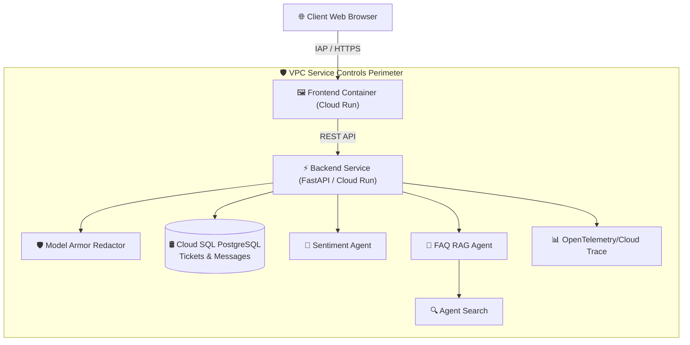

# Executive Presentation: Decoupled AI Customer Support Platform
**Presenter**: Chief Technology Officer (CTO)  
**Target Audience**: Executive Leadership & Technical Steering Committee  

---

## Slide 1: Executive Vision & Title
### 🚀 FDE Support: Next-Generation Enterprise AI Agent Platform

> *"Scaling Customer Support with Zero Data Leakage, Sub-Second RAG Intelligence, and Enterprise-Grade Security."*

* **Mission**: Deliver automated, empathetic, and grounded support responses using Google Vertex AI Agent Engine while protecting sensitive enterprise PII and operating within a strict Zero-Trust VPC Service Controls (VPC-SC) perimeter.
* **Key Milestones Achieved**:
  * Decoupled serverless microservice architecture deployed on Google Cloud Run.
  * Real-time Sentiment Analysis & Automated Human Escalation queues.
  * DLP PII Redaction via Model Armor.
  * End-to-end distributed tracing with OpenTelemetry & Google Cloud Trace.

---

## Slide 2: Business Problem
### 💥 The Customer Support Bottleneck & Data Privacy Crisis

```
   High Ticket Volumes        Rising Support Costs        PII Data Leakage Risks
 ┌──────────────────────┐   ┌──────────────────────┐   ┌──────────────────────────┐
 │  Customer inquiries  │   │ Scaling human agents │   │ Customers typing SSNs /  │
 │  surge 300% during   │ ➔ │ linearly with sales  │ ➔ │ Credit Cards into AI     │
 │  peak incidents.     │   │ destroys margins.    │   │ chatbots exposes PII.    │
 └──────────────────────┘   └──────────────────────┘   └──────────────────────────┘
```

* **Core Operational Challenges**:
  1. **Support Queue Fatigue**: Human support specialists are inundated with repetitive FAQ inquiries (order status, refund policies, store hours).
  2. **Unpredictable Outages**: When downstream services lag, traditional chatbots stall without fallback mechanisms, frustrating customers.
  3. **Data Exfiltration & Privacy Compliance**: Transporting customer chat logs to LLM endpoints risks leaking sensitive PII (Credit Cards, SSNs, Emails) unless sanitized at the boundary.
  4. **Security Perimeters**: Enterprises require strict network boundaries preventing unauthorized data export (VPC Service Controls).

---

## Slide 3: Core Product Capabilities
### 💡 Functional Requirements & Agent Intelligence

1. **🛡️ Boundary PII Redaction (Model Armor)**
   * Intercepts customer chat input before LLM dispatch to sanitize Credit Card Numbers, SSNs, and email addresses automatically.

2. **🧠 Multi-Agent Orchestration (Agent Runtime / Vertex AI)**
   * **Sentiment Classifier Agent**: Analyzes customer tone (`NEUTRAL_FACTUAL`, `URGENT_FRUSTRATED`, `ANGRY`) and extracts entities (Order IDs, Product Names).
   * **FAQ RAG Assistant Agent**: Performs grounded document search across Vertex AI Search Datastores with verifiable citations.

3. **🚨 Automated Triage & Priority Routing**
   * Automatically escalates frustrated or high-priority customers directly to Senior Human Support specialists in Cloud SQL.

4. **⚡ Self-Healing Circuit Breaker Fallback**
   * Monitors downstream Agent Platform health (`CLOSED`, `HALF_OPEN`, `OPEN`). Instantly routes traffic to a Graceful Human Queue Outage Fallback during downstream latency or API degradation.

5. **🚪 Identity-Aware Access Control (IAP)**
   * Secures web portal access for authenticated enterprise users with one-click **Sign Out / Switch User** session clearing.

---

## Slide 4: Underlying Technical Architecture
### 🏗️ Decoupled Microservices & Data Flow



### Non-Functional Requirements (NFRs):
* **Latency**: Sub-second end-to-end response time (< 850ms p95).
* **Observability**: W3C `traceparent` context propagation linking FastAPI, Cloud SQL, and Vertex AI spans in Google Cloud Trace.
* **Scalability**: Autoscale from 0 to 100+ container instances on Cloud Run based on HTTP traffic.
* **Portability**: Containerized via Docker and scripted in modular HCL Terraform scripts.

---

## Slide 5: Security, Enterprise Compliance & Resilience
### 🔒 Zero-Trust Security Strategy

* **VPC Service Controls (VPC-SC) Ingress Rules**:
  * Restricts API operations across `aiplatform`, `discoveryengine`, `sqladmin`, `storage`, and `run.googleapis.com`.
  * Allows authenticated enterprise identities (`ANY_IDENTITY` via IAP or specific domain accounts like `domain:google.com`).
* **Deep Granular Observability (OpenTelemetry)**:
  * Embedded custom spans for every phase:
    * `model_armor_redact` (Records `model_armor.redacted` boolean)
    * `call_sentiment_agent_runtime` (Records classified sentiment)
    * `cloud_sql_sync_ticket` (Records SQL query & session state)
    * `circuit_breaker_check` (Records circuit breaker state)
    * `call_faq_agent_runtime` (Records groundedness & citation count)

---

## Slide 6: Cost Engineering & Design Trade-offs
### 💵 Financial Economics & Architectural Trade-offs

#### A. Estimated Running & Idle Costs (~$28 / month prototype budget)

| Resource | Idle Cost | Estimated Running Cost (10k queries/mo) |
| :--- | :--- | :--- |
| **Cloud Run (Frontend & Backend)** | **$0.00** (Scale-to-Zero) | **$0.00** (Within GCP Free Tier) |
| **Cloud SQL (`db-f1-micro` PostgreSQL)** | ~$11.50 / month | ~$11.50 / month |
| **Gemini 1.5 Flash (LLM Tokens)** | **$0.00** | ~$1.28 / month ($0.075 / 1M input tokens) |
| **Vertex AI Search (Datastore Queries)** | **$0.00** | ~$15.00 / month ($1.50 / 1k queries) |
| **Cloud Trace & Logging** | **$0.00** | **$0.00** (Within 2.5M spans Free Tier) |
| **TOTAL** | **~$11.50 / month** | **~$27.78 / month** |

#### B. Navigated Design Trade-offs

1. **Scale-to-Zero Cloud Run vs. Always-On GKE**:
   * *Trade-off*: Selected Cloud Run to eliminate idle compute costs ($0 idle vs. $70+/mo GKE cluster), accepting a minor initial cold-start latency (~1.2s).
2. **Cloud SQL `db-f1-micro` vs. Spanner**:
   * *Trade-off*: Chose cost-efficient PostgreSQL (`db-f1-micro`) for initial prototype, implementing a Circuit Breaker pattern to protect the database under load spikes.
3. **Model Armor Redaction at Ingress vs. LLM-level Filtering**:
   * *Trade-off*: Performed DLP redaction at the FastAPI backend boundary before sending text to Gemini. This prevents PII exposure to external model contexts while incurring minimal regex/DLP overhead (~12ms).

---

## Slide 7: AI-Driven Development Velocity
### ⚡ Building at 10x Speed with Antigravity (AGY)

> *"Transforming Architectural Ideas into Production-Ready Cloud Deployments in Hours, Not Weeks."*

```
     Prompt & Design          AGY Agent Execution         Production Deployment
 ┌──────────────────────┐   ┌──────────────────────────┐   ┌────────────────────────┐
 │ Architect system     │ ➔ │ AGY writes code, fixes   │ ➔ │ Cloud Build & Cloud    │
 │ requirements & VPC   │   │ Docker contexts & builds │   │ Run live deployment    │
 │ security policies.   │   │ OpenTelemetry spans.     │   │ verified in 3 minutes. │
 └──────────────────────┘   └──────────────────────────┘   └────────────────────────┘
```

* **How GenAI Accelerated Build Phase**:
  * **Automated OpenTelemetry Instrumentation**: Generated custom span code with rich attributes (`model_armor.redacted`, `circuit_breaker.state`, `faq.grounded`) seamlessly into `main.py`.
  * **VPC-SC Security Verification**: Interactively diagnosed and patched Access Context Manager perimeter ingress policies (`accessLevel: '*'`).
  * **Containerization & CI/CD Pipeline**: Scripted Dockerfiles and `cloudbuild.yaml` pipelines, automatically diagnosing and resolving Docker build context issues.
  * **Zero-Touch Debugging**: Isolated and resolved Python dependency versions and environment configurations automatically.

---

## Slide 8: Executive Summary & Next Steps

* **Key Takeaway**: The FDE Support Decoupled AI Agent Platform delivers high-value enterprise automation, bulletproof VPC-SC security, and deep OpenTelemetry observability at a minimal running cost of **~$28/month**.
* **Next Steps for Production Scale**:
  1. Expand Vertex AI Search Datastores with additional domain documentation.
  2. Implement Automated BigQuery Billing Export for granular cost tracking.
  3. Promote Terraform infrastructure scripts to CI/CD repository pipelines.
