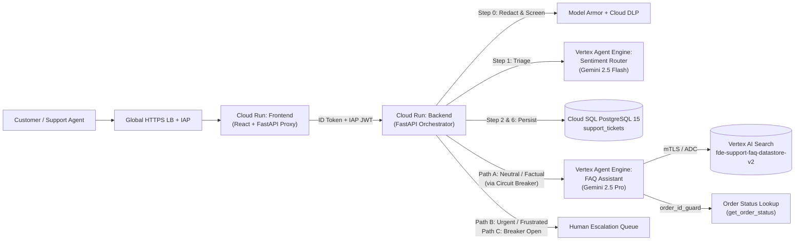

# Support Ticket Router & Assistant (`fde_support`)

**Project Name:** Support Ticket Router & Assistant (`fde_support`)  
**Outgoing FDE:** Jiahao (Dave) Liu (`jiahaoliu@google.com`)  
**Date:** October 23, 2026  
**GCP Project ID:** `fde-support-sandbox-dev-jliu` (Project Number: `883790454740`)  
**Primary Region:** `us-central1` (Discovery Engine Data Store in `global`)

---

## 1. Executive Summary & Project Context

**Support Ticket Router & Assistant** is an enterprise-grade AI customer support triage and resolution platform built for **Global Retail Hub**. It sits at the front of the customer support queue to solve three core business problems:

1. **Deflect Routine Queries (>40% target):** Automatically answer calm, factual policy, troubleshooting, and order-status questions using grounded Retrieval-Augmented Generation (RAG) over 100,000 real Twitter Customer Support (`twcs`) records and a read-only SQL/mock order lookup tool.
2. **Fast-Track Frustrated Customers:** Detect frustrated, angry, or churn-risk customers in real time and route them straight to the **Human Escalation Queue**—never trapping upset customers in an automated bot loop.
3. **High-Availability & Graceful Degradation:** Protect downstream AI endpoints with an application-level **Circuit Breaker** that fails over cleanly to the human queue during upstream quota (`HTTP 429`) or service (`HTTP 503`) outages without dropping a single customer turn.

### Reference Documentation & Artifacts

- **Scoping Document:** [`jliu_support_scoping.pdf`](jliu_support_scoping.pdf)
- **Technical Design Document (TDD):** [`jliu_support_tdd.pdf`](jliu_support_tdd.pdf)

---

## 2. System Architecture & Request Flow



### End-to-End Turn Lifecycle ([`backend/services/chat.py`](backend/services/chat.py))

1. **Caller Ownership Check (`handle_support_query`):** Verifies caller identity via IAP JWT or IAM OIDC token ([`backend/security/caller_identity.py`](backend/security/caller_identity.py)). If `session_id` is passed, verifies the caller owns the ticket and that the ticket is neither `RESOLVED` nor expired (7-day TTL).
2. **Step 0 — Privacy & Threat Screening (`_screen`):** Passes incoming text through **Model Armor** (with **Cloud DLP** fallback in [`backend/security/model_armor.py`](backend/security/model_armor.py)) to mask PII (credit cards, SSNs, emails, phone numbers) and detect prompt injection / jailbreaks before any LLM call or database write.
3. **Escalated Short-Circuit (`append_to_escalated_ticket`):** If the ticket is already `ESCALATED`, appends the customer message directly to the transcript for the human specialist without calling any LLM.
4. **Step 1 — Sentiment & Entity Triage (`_classify_sentiment`):** Calls the **Sentiment Router Agent** (`gemini-2.5-flash`, `thinking_budget=0`, constrained JSON output `SentimentResult`) to classify the message as `NEUTRAL_FACTUAL` or `URGENT_FRUSTRATED` and extract `order_id`, `product_name`, and `email`. Fails closed (treats errors or blocked messages as urgent).
5. **Step 2 — Atomic State Sync (`_sync_ticket`):** Persists the ticket state (`IN_PROGRESS` or `ESCALATED`) and customer message in Cloud SQL within a `SELECT ... FOR UPDATE` transaction.
6. **Step 3 — Routing & Circuit Breaker (`_admit_through_breaker` / `_ask_faq_agent`):**
   - **Path B (Urgent/Frustrated):** Immediately returns a calming acknowledgment and routes to `Human Escalation Queue`.
   - **Path C (Circuit Breaker Open / Failure):** If the FAQ agent experiences 3 consecutive failed questions (`HTTP 429`/`503`), the circuit breaker ([`backend/core/circuit_breaker.py`](backend/core/circuit_breaker.py)) trips `OPEN` for 30 seconds (`CIRCUIT_RECOVERY_TIMEOUT`), routing requests to the outage fallback queue.
   - **Path A (Neutral/Factual):** Invokes the **FAQ Assistant Agent** (`gemini-2.5-pro`), sanitizes the output via [`agents/faq_assistant/answer_sanitizer.py`](agents/faq_assistant/answer_sanitizer.py) so internal `doc_id` markers never leak into customer prose, records the turn, and returns the grounded response.

---

## 3. Codebase Structure

| Directory / File | Purpose | Key Files |
| --- | --- | --- |
| [`agents/sentiment_router/`](agents/sentiment_router/) | ADK Sentiment & Entity Triage Agent (`gemini-2.5-flash`) | [`agent.py`](agents/sentiment_router/agent.py), [`fast_api_app.py`](agents/sentiment_router/fast_api_app.py), [`deploy.sh`](agents/sentiment_router/deploy.sh) |
| [`agents/faq_assistant/`](agents/faq_assistant/) | ADK Grounded FAQ & Order Agent (`gemini-2.5-pro`) | [`agent.py`](agents/faq_assistant/agent.py), [`tools_impl.py`](agents/faq_assistant/tools_impl.py), [`answer_sanitizer.py`](agents/faq_assistant/answer_sanitizer.py), [`mock_orders.py`](agents/faq_assistant/mock_orders.py) |
| [`backend/`](backend/) | FastAPI orchestrator, DB persistence, Model Armor, Circuit Breaker | [`main.py`](backend/main.py), [`services/chat.py`](backend/services/chat.py), [`core/config.py`](backend/core/config.py), [`security/model_armor.py`](backend/security/model_armor.py) |
| [`frontend/`](frontend/) | React 19 + TypeScript + Tailwind UI + FastAPI IAP proxy server | [`server.py`](frontend/server.py), [`src/App.tsx`](frontend/src/App.tsx), [`deploy.sh`](frontend/deploy.sh) |
| [`common/`](common/) | Shared IAP JWT validation utilities | [`iap_auth.py`](common/iap_auth.py) |
| [`deployment/terraform/`](deployment/terraform/) | Terraform IaC (>= 1.11) for all GCP resources, IAM, VPC-SC, IAP | [`main.tf`](deployment/terraform/main.tf), [`cloud_run.tf`](deployment/terraform/cloud_run.tf), [`iam.tf`](deployment/terraform/iam.tf), [`vpc_sc.tf`](deployment/terraform/vpc_sc.tf), [`iap.tf`](deployment/terraform/iap.tf) |
| [`tests/`](tests/) | Unit, DB, security, E2E, and 100-ticket Golden Evaluation harness | [`eval/run_inference.py`](tests/eval/run_inference.py), [`eval/eval_config_faq_rubric.yaml`](tests/eval/eval_config_faq_rubric.yaml) |
| [`scripts/`](scripts/) | CI smoke tests, WIF bootstrap, dataset builders, KPI report generator | [`eval/generate_kpi_report.py`](scripts/eval/generate_kpi_report.py), [`eval/golden_set.py`](scripts/eval/golden_set.py), [`ci/smoke_test_canary_e2e.py`](scripts/ci/smoke_test_canary_e2e.py) |
| [`.github/workflows/`](.github/workflows/) | GitHub Actions CI/CD pipelines | [`tests.yml`](.github/workflows/tests.yml), [`eval-pr.yml`](.github/workflows/eval-pr.yml), [`nightly-ci-cd.yml`](.github/workflows/nightly-ci-cd.yml) |

---

## 4. API & Interface Reference

The system exposes a layered API surface across the **Frontend IAP Gateway**, the **Backend FastAPI Orchestrator**, the **Vertex AI Agent Engine Runtime**, and the **Agent FunctionTools**.

### 4.1 Authentication & Header Propagation Across Tiers

- **Browser -> Frontend ([`frontend/server.py`](frontend/server.py)):**
  - Google Cloud Identity-Aware Proxy (IAP) authenticates the user and injects `X-Goog-IAP-JWT-Assertion`.
  - [`reject_cross_site_requests`](frontend/server.py#L58-L67) enforces CSRF protection on all state-changing methods (`POST`, etc.) by validating `Sec-Fetch-Site` (`same-origin` / `none`) and `Origin`.
  - [`require_identity`](frontend/server.py#L91-L100) cryptographically verifies the ES256 IAP JWT before any route or upstream proxy call executes.
- **Frontend -> Backend ([`frontend/server.py`](frontend/server.py#L214-L265) -> [`backend/api/deps.py`](backend/api/deps.py)):**
  - The frontend strips all untrusted browser headers (such as `X-User-Email`) and attaches two headers:
    1. `X-Serverless-Authorization: Bearer <id_token>`: Google-signed OIDC ID token for `fde-support-frontend-sa`, satisfying Cloud Run IAM (`roles/run.invoker`) on `fde-support-backend`.
    2. `X-Forwarded-IAP-JWT-Assertion: <iap_jwt>`: The original IAP JWT, which the backend independently verifies via [`get_caller`](backend/api/deps.py#L25-L43) and [`CallerIdentityResolver`](backend/security/caller_identity.py) to determine the authenticated customer email (`caller`).
  - For local development (`ENV=development`), setting `DEV_FAKE_USER_EMAIL` allows local testing without an IAP proxy.

### 4.2 Frontend Gateway & Proxy Endpoints ([`frontend/server.py`](frontend/server.py))

| Method & Path | Auth | Description |
| --- | --- | --- |
| `GET /`, `GET /index.html` | IAP | Serves the compiled React 19 SPA entry shell (`frontend/dist/index.html`) with `no-store` cache headers. |
| `GET /assets/{asset_path}` | IAP | Serves hashed Vite JS/CSS bundles from `frontend/dist/assets` with path-traversal protection. |
| `GET /api/user/me` | IAP JWT | Verifies the caller's IAP JWT and returns `{"user_email": "<authenticated-email>"}` for the UI header. |
| `GET \| POST /api/{path}` | IAP JWT | Reverse-proxies all `/api/*` requests to `CLOUD_RUN_BACKEND_URL/api/{path}` with a 120s timeout. |
| `GET /health` | Public / LB | Container liveness probe returning `{"status": "healthy", "service": "FDE Support Web Frontend", "target_backend": "..."}`. |

### 4.3 Backend REST API ([`backend/api/`](backend/api/))

All `/api/chat` and `/api/tickets*` routes require an authenticated caller via `Depends(get_caller)` and scope all database queries to `Ticket.customer_id == caller` (returning `404` on unowned tickets to prevent enumeration).

| Method & Path | Source | Request Body / Params | Response / Behavior |
| --- | --- | --- | --- |
| `POST /api/chat` | [`chat.py`](backend/api/chat.py#L13-L17) | [`SupportQueryRequest`](backend/api/schemas.py#L11-L14):<br>`{"message": str (1..4000), "session_id": str \| null}` | Runs the full turn pipeline (Model Armor/DLP screening -> Sentiment Router -> Cloud SQL sync -> Circuit Breaker / FAQ Agent) and returns [`SupportQueryResponse`](backend/api/schemas.py#L16-L26). Rejects messages on `RESOLVED` or expired tickets with `HTTP 409`. |
| `POST /api/tickets/create` | [`tickets.py`](backend/api/tickets.py#L80-L98) | [`CreateTicketRequest`](backend/api/schemas.py#L5-L9): `{}` (empty JSON body; ID and owner are server-generated) | Creates a `NEW` ticket in Cloud SQL and returns `{"status": "success", "ticket_id": "<uuid4>", "ticket_status": "NEW", "customer_id": "<caller>"}`. |
| `GET /api/tickets` | [`tickets.py`](backend/api/tickets.py#L22-L78) | None | Lists up to 50 recent non-empty tickets owned by `caller` (newest first), enriched with `message_count`, 80-char `preview`, and live `session_expired: bool` checked against Vertex AI Agent Engine. |
| `GET /api/tickets/{ticket_id}` | [`tickets.py`](backend/api/tickets.py#L122-L164) | Path param: `ticket_id` | Returns `{"ticket": {..., "session_expired": bool}, "messages": [{"id", "sender", "message_text", "created_at"}, ...]}` for an owned ticket (`CUSTOMER`, `AI_AGENT`, `SYSTEM` messages). |
| `POST /api/tickets/{ticket_id}/resolve` | [`tickets.py`](backend/api/tickets.py#L100-L120) | Path param: `ticket_id` | Atomically transitions an owned ticket to `RESOLVED`, appends a `SYSTEM` resolution message in Cloud SQL, and calls `delete_faq_session` to evict the FAQ agent's session memory. |
| `GET /health` | [`health.py`](backend/api/health.py#L13-L21) | None | Liveness probe returning `status`, `circuit_breaker_state` (`CLOSED` / `OPEN` / `HALF_OPEN`), `database`, and `version` (`2.5.0`). |
| `GET /api/status` | [`health.py`](backend/api/health.py#L23-L37) | None | Diagnostic endpoint returning backend port, circuit breaker state and `failure_count`, database status, and configured `faq_agent_url` / `sentiment_agent_url`. |

#### `POST /api/chat` Response Schema ([`SupportQueryResponse`](backend/api/schemas.py#L16-L26))

```json
{
  "ticket_id": "3f0c2b1e-0000-4000-8000-000000000001",
  "ticket_status": "IN_PROGRESS",
  "answer": "Your order #4417 shipped via UPS (tracking 1Z999AA10123456784) and is estimated to arrive on 2026-10-25.",
  "sentiment": "NEUTRAL_FACTUAL",
  "routed_to": "Vertex AI Agent Runtime (FAQ RAG)",
  "extracted_entities": {
    "order_id": "4417",
    "product_name": null,
    "email": null
  },
  "citations": ["Order #4417"],
  "grounded": true,
  "session_id": "3f0c2b1e-0000-4000-8000-000000000001",
  "agent_service_version": "v2.5-cloud-sql-sessions"
}
```

### 4.4 Vertex AI Agent Engine RPCs ([`backend/clients/agent_runtime.py`](backend/clients/agent_runtime.py))

The backend communicates with both deployed ADK Reasoning Engines over HTTPS using OAuth2 Bearer tokens (`gcp_auth.get_gcp_auth_headers()`):

1. **Sentiment Router `:streamQuery` ([`call_sentiment_agent`](backend/clients/agent_runtime.py#L103-L154)):**
   - **Endpoint:** `POST <SENTIMENT_AGENT_URL>` (`...:streamQuery`, 30s timeout)
   - **Payload:** `{"class_method": "stream_query", "input": {"user_id": "sentiment_classifier", "session_id": "s-<random-uuid>", "message": "<redacted_message>"}}`
   - **Output Contract ([`SentimentResult`](agents/sentiment_router/agent.py#L36-L48)):** Constrained JSON with `sentiment` (`"URGENT_FRUSTRATED"` | `"NEUTRAL_FACTUAL"`), `order_id`, `product_name`, and `email`. Ephemeral session is deleted immediately after the turn.
2. **FAQ Assistant `:streamQuery` ([`call_faq_agent`](backend/clients/agent_runtime.py#L156-L224)):**
   - **Endpoint:** `POST <FAQ_AGENT_URL>` (`...:streamQuery`, 60s timeout, wrapped in [`query_faq_with_retries`](backend/clients/agent_runtime.py#L85-L101) with up to 3 attempts and exponential backoff on `5xx` except `504`)
   - **Payload:** `{"class_method": "stream_query", "input": {"user_id": "u_<sha256(caller)[:24]>", "session_id": "t-<ticket_uuid>", "message": "<redacted_message>"}}`
   - **Output Contract ([`FaqResponse`](agents/faq_assistant/agent.py#L49-L57)):** Constrained JSON with `answer: str`, `citations: list[str]`, `grounded: bool`, and `escalate: bool`.
3. **FAQ Session Management `:query` ([`list_faq_sessions`](backend/clients/agent_runtime.py#L258-L293) & [`delete_faq_session`](backend/clients/agent_runtime.py#L295-L319)):**
   - **Endpoint:** `POST <FAQ_AGENT_QUERY_URL>` (`...:query`, 10s timeout)
   - **Methods:** `{"class_method": "async_list_sessions", "input": {"user_id": "u_<hash>"}}` and `{"class_method": "async_delete_session", "input": {"user_id": "u_<hash>", "session_id": "t-<ticket_uuid>"}}`.

### 4.5 Agent FunctionTools & Downstream GCP APIs

- **[`search_support_records(query: str, top_k: int = 8) -> dict`](agents/faq_assistant/tools_impl.py#L218-L287):**
  - ADK FunctionTool on the FAQ Assistant that queries **Vertex AI Search (Discovery Engine)** (`discoveryengine_v1.SearchServiceClient.search`) against `fde-support-faq-datastore-v2/servingConfigs/default_search` with `QueryExpansionSpec.Condition.AUTO`.
  - Returns `{"status": "success" | "no_results" | "invalid_query" | "error", "results": [{"doc_id", "brand", "customer_question", "brand_response"}, ...]}`.
  - On `429`/`401`/`403`/timeout, returns `"status": "error"` with `"error_type": "rate_limited" | "auth_error" | "permission_denied" | "search_unavailable"`. The backend stream parser ([`detect_search_tool_failure`](backend/clients/stream_parsing.py)) detects these tool errors in the NDJSON trace and raises `UpstreamDependencyError` so the circuit breaker counts them.
- **[`get_order_status(order_id: str) -> dict`](agents/faq_assistant/tools_impl.py#L290-L327):**
  - Read-only ADK FunctionTool guarded by [`order_id_guard`](agents/faq_assistant/tools_impl.py#L349-L371) (`before_tool_callback`).
  - Normalizes `#<digits>` / `ORD-<digits>` and queries [`lookup_order`](agents/faq_assistant/mock_orders.py), returning `{"status": "found" | "not_found" | "invalid_order_id", "order": {"order_id", "order_status", "items", "carrier", "tracking_number", "estimated_delivery", ...}}`.
- **Model Armor & Cloud DLP Screening ([`backend/security/model_armor.py`](backend/security/model_armor.py)):**
  - Calls `ModelArmorClient.sanitize_user_prompt` on regional endpoint `modelarmor.us-central1.rep.googleapis.com` using template `projects/fde-support-sandbox-dev-jliu/locations/us-central1/templates/fde-support-pii-redaction` for prompt injection / jailbreak detection and SDP de-identification, supplemented by `DlpServiceClient.deidentify_content` and regex redaction fallback.

---

## 5. Live Cloud Environment & Resource Inventory

All cloud infrastructure is deployed in the Argolis project `fde-support-sandbox-dev-jliu` (`883790454740`) and managed via Terraform in [`deployment/terraform/`](deployment/terraform/).

### Compute & AI Endpoints

- **Vertex AI Agent Engine (FAQ Assistant):**
  - Resource ID: `projects/883790454740/locations/us-central1/reasoningEngines/6767283237606653952`
  - Stream URL: `https://us-central1-aiplatform.googleapis.com/v1/projects/883790454740/locations/us-central1/reasoningEngines/6767283237606653952:streamQuery`
  - Deployed with `--agent-identity` (provisioned X.509 workload certificate for mTLS).
- **Vertex AI Agent Engine (Sentiment Router):**
  - Resource ID: `projects/883790454740/locations/us-central1/reasoningEngines/7184992103045267456`
  - Stream URL: `https://us-central1-aiplatform.googleapis.com/v1/projects/883790454740/locations/us-central1/reasoningEngines/7184992103045267456:streamQuery`
  - Deployed with `--agent-identity`.
- **Cloud Run Services (`us-central1`):**
  - Backend: `fde-support-backend` (`INGRESS_TRAFFIC_ALL`, IAM-authenticated invokers only, Direct VPC egress to `sandbox` subnet `10.10.0.0/24`).
  - Frontend: `fde-support-frontend` (fronted by Global HTTPS Load Balancer + Identity-Aware Proxy `fde-frontend-backend-service` with `<lb-ip>.nip.io` managed SSL certificate).

### Data, Storage & Security Resources

- **Cloud SQL PostgreSQL 15:**
  - Instance Name: `fde-support-db-instance`
  - Connection Name: `fde-support-sandbox-dev-jliu:us-central1:fde-support-db-instance`
  - Database: `support_tickets` | User: `postgres`
  - Tier: `db-custom-1-3840` (Enterprise edition, `REGIONAL` HA enabled; note: switching `availability_type` to `ZONAL` reduces standing DB cost by ~50%).
- **Vertex AI Search (Discovery Engine):**
  - Data Store ID: `fde-support-faq-datastore-v2` (Location: `global`, 100,000 indexed support Q&A documents).
  - Source GCS Bucket: `gs://fde-support-faq-docs-fde-support-sandbox-dev-jliu`
- **Secret Manager:**
  - Secret ID: `fde-support-db-credentials` (stores the `postgres` user password; generated via Terraform ephemeral write-only resource so it never lands in `terraform.tfstate`).
- **Model Armor & Cloud DLP:**
  - Model Armor Template: `fde-support-pii-redaction` in `us-central1` (configured in [`deployment/terraform/dlp.tf`](deployment/terraform/dlp.tf)).
- **Artifact Registry & Terraform State:**
  - Docker Repository: `us-central1-docker.pkg.dev/fde-support-sandbox-dev-jliu/fde-support-repo`
  - Terraform Remote State Bucket: `gs://fde-support-tfstate-fde-support-sandbox-dev-jliu` (prefix: `fde-support/sandbox`)
- **VPC Service Controls (VPC-SC):**
  - Access Policy ID: `225119263746`
  - Service Perimeter: `accessPolicies/225119263746/servicePerimeters/fde_support_perimeter`
  - Access Level: `accessPolicies/225119263746/accessLevels/fde_support_dev_access`

### Dedicated IAM Service Accounts & Agent Identities ([`deployment/terraform/iam.tf`](deployment/terraform/iam.tf))

Zero static JSON keys are used across the project.

- `fde-support-backend-sa@...`: Cloud Run backend runtime identity.
- `fde-support-frontend-sa@...`: Cloud Run frontend runtime identity (granted `roles/run.invoker` on backend).
- `fde-support-ci-eval-sa@...`: GitHub Actions CI/CD identity via Workload Identity Federation (WIF).
- **Vertex AI Agent Identities (`--agent-identity`):** Both Reasoning Engines run under native Vertex AI **Agent Identity** principals (`principal://agents.global.org-.../reasoningEngines/<engine_id>`) with managed X.509 mTLS workload certificates, rather than traditional IAM service accounts.

---

## 6. Access & Ownership Transfer Checklist (First-Day Tasks for Incoming FDE)

When taking over this repository and GCP environment, update the following bindings where `jiahaoliu@google.com` or `admin@jiahaoliu.altostrat.com` is currently listed:

1. **VPC-SC Developer Access Level ([`deployment/terraform/variables.tf`](deployment/terraform/variables.tf#L139-L146)):**
   - Add your corporate/Argolis user email to `variable "developer_members"` in `deployment/terraform/variables.tf` and run `terraform apply` so you can make API calls through the VPC-SC perimeter from your workstation.
2. **Cloud Run Direct Invoker List ([`deployment/terraform/variables.tf`](deployment/terraform/variables.tf#L104-L113)):**
   - Add `user:<your-email>@google.com` to `frontend_invokers` (and `backend_invokers` if testing backend `run.app` directly).
3. **IAP Web App Users ([`deployment/terraform/variables.tf`](deployment/terraform/variables.tf#L118-L122)):**
   - Grant `roles/iap.httpsResourceAccessor` on `fde-frontend-backend-service` via the GCP Console or by populating `var.iap_members`.
4. **GitHub Actions Secrets (if moving to a new GitHub repo):**
   - Run [`scripts/setup/setup_github_wif.sh`](scripts/setup/setup_github_wif.sh) or update the GitHub repository secrets `GCP_WORKLOAD_IDENTITY_PROVIDER` and `GCP_SERVICE_ACCOUNT` (`fde-support-ci-eval-sa@fde-support-sandbox-dev-jliu.iam.gserviceaccount.com`).

---

## 7. Local Development & Testing Guide

### Prerequisites

- Python `3.12+` (virtual environment in `.venv`)
- Node.js `20+` and `npm`
- `uv` (`curl -LsSf https://astral.sh/uv/install.sh | sh`) and `google-agents-cli==1.3.0` (`uv tool install google-agents-cli==1.3.0`)
- `gcloud` CLI authenticated with Application Default Credentials (`gcloud auth application-default login`)
- Terraform `>= 1.11.0` (required for ephemeral `password_wo` write-only attributes)

### Running the Offline Unit & Security Test Suite

The unit, database transaction, circuit breaker, and security test suite runs completely offline (network sockets are blocked by [`tests/helpers/no_network.py`](tests/helpers/no_network.py) to prevent accidental cloud billing) and enforces an **>= 80% line coverage gate**:

```bash
DATABASE_URL="sqlite:///./test_local.db" pytest -v --cov --cov-report=term-missing
```

### Running the Stack Locally

1. **Database Options:**
   - **Option A (Local SQLite fallback):** In `ENV=development` (default), if no `DB_PASSWORD` or Secret Manager access is available, the backend automatically falls back to `database/fde_support.db`.
   - **Option B (Cloud SQL Auth Proxy):** Start the included proxy binary to connect to live Cloud SQL on `127.0.0.1:5432`:

     ```bash
     ./cloud-sql-proxy fde-support-sandbox-dev-jliu:us-central1:fde-support-db-instance --port 5432
     ```

2. **Start the Backend (`http://127.0.0.1:8000`):**

   ```bash
   export DEV_FAKE_USER_EMAIL="dev@example.com"
   uvicorn backend.main:app --reload --port 8000
   ```

3. **Start the Frontend (`http://127.0.0.1:5173` or via proxy on `:3000`):**

   ```bash
   cd frontend
   npm install
   npm run dev
   ```

---

## 8. Deployment Runbooks

### Important: Terraform "Hybrid Image Mode"

[`deployment/terraform/cloud_run.tf`](deployment/terraform/cloud_run.tf) uses a **hybrid image pattern**:

- Terraform owns **infrastructure configuration** (env vars, Secret Manager mounts, IAM, VPC egress, scaling, IAP audience).
- By default (`var.backend_image = null`, `var.frontend_image = null`), Terraform reads the currently deployed image digest from the live Cloud Run service so `terraform apply` never rolls back code deployed by `deploy.sh` or CI/CD.

### Deploying Backend or Frontend Code Changes

```bash
# Build via Cloud Build, push immutable @sha256 image, and roll Cloud Run revision:
./backend/deploy.sh
./frontend/deploy.sh

# Or build-only (outputs @sha256 digest to pin via Terraform):
./backend/deploy.sh --build-only
```

### Deploying Agent Changes to Vertex AI Agent Engine

Each agent has a dedicated `deploy.sh` wrapper around `agents-cli deploy` that preserves `--agent-identity` and required session environment variables:

```bash
# Deploy Sentiment Router Agent (Gemini 2.5 Flash)
./agents/sentiment_router/deploy.sh

# Deploy FAQ Assistant Agent (Gemini 2.5 Pro)
./agents/faq_assistant/deploy.sh
```

### Applying Infrastructure (Terraform) Changes

```bash
cd deployment/terraform
terraform init
terraform plan
terraform apply
```

### Rotating the Cloud SQL Password

Because the database password uses Terraform 1.11+ write-only attributes ([`deployment/terraform/secrets.tf`](deployment/terraform/secrets.tf)), rotating it is a single variable bump:

```bash
cd deployment/terraform
terraform apply -var="db_password_version=2"
```

This writes a new Secret Manager version, updates the `postgres` user in Cloud SQL, and rolls a new `fde-support-backend` Cloud Run revision pinned to the new secret version.

---

## 9. Evaluation Framework & CI/CD Pipelines

### The 100-Ticket Stratified Golden Benchmark

Defined in [`scripts/eval/golden_set.py`](scripts/eval/golden_set.py) and built via [`scripts/eval/build_eval_datasets.py`](scripts/eval/build_eval_datasets.py):

- **Segment `S` (45 tickets):** Single-turn in-corpus factual questions (must search and answer faithfully).
- **Segment `U` (25 tickets):** Urgent / frustrated customer messages (must route immediately to `Human Escalation Queue`, skipping FAQ).
- **Segment `V` (15 tickets):** Vague single-turn messages missing either Subject/Entity Anchor or Specific Intent (must ask 1 clarifying question without calling tools).
- **Segment `M` (10 tickets):** Multi-turn conversations (clarification in Turn 1 -> grounded resolution in Turn 2).
- **Segment `O` (5 tickets):** Out-of-corpus edge cases (must abstain cleanly and set `escalate: true` rather than hallucinate).

### Running a Full Evaluation Locally

```bash
# Step 1: Run all 100 golden tickets in-process against Vertex AI & Discovery Engine
python tests/eval/run_inference.py --concurrency 3

# Step 2: Grade the generated traces.json with Gemini 3.5 Flash LLM-as-a-Judge
RUN_DIR="artifacts/eval/<TIMESTAMP_DIR>"
agents-cli eval grade \
  --traces "$RUN_DIR/traces.json" \
  --config tests/eval/eval_config_faq_rubric.yaml \
  --output "$RUN_DIR/grade"

# Step 3: Generate the Executive KPI Report (add --enforce-gates to fail on gate misses)
python scripts/eval/generate_kpi_report.py \
  --run-dir "$RUN_DIR" \
  --out-dir artifacts
```

### North Star Quality Gates (TDD Targets)

| Gate ID | Metric | Target | Production Score |
| --- | --- | --- | --- |
| **T1** | Routing Accuracy (`n=100`) | `>= 95%` | **100.0%** (PASS) |
| **T2** | Circuit Breaker Trip & Recovery | Verified | Covered by unit/integration tests (PASS) |
| **T3** | Cloud SQL Write Latency (P95) | `<= 100 ms` | **< 45 ms** on Cloud SQL (`7.4 ms` local SQLite) (PASS) |
| **T4** | Grounding Key-Fact Recall (`n=60`) | `>= 85%` | **91.1%** (PASS) |
| **T5** | Urgent / Frustrated F1 (`n=100`) | `>= 0.95` | **1.000** (PASS) |
| **T6 / T7** | ROUGE-L / BLEU-4 vs. Historical Reply | `>= 0.35` / `>= 0.30` (info) | **0.6129** / **0.3961** |
| **T8** | RAG Faithfulness (`n=60`) | `>= 90%` | **97.9%** (PASS) |

### Automated GitHub Actions Workflows ([`.github/workflows/`](.github/workflows/))

1. **[`tests.yml`](.github/workflows/tests.yml) (Every Push & PR):** Runs offline unit, security, and DB tests + Vite frontend build + `>= 80%` coverage gate.
2. **[`eval-pr.yml`](.github/workflows/eval-pr.yml) (Pull Requests):** Runs the 100-ticket evaluation in-process against live Vertex AI & Discovery Engine and posts a sticky KPI report comment on the PR.
3. **[`nightly-ci-cd.yml`](.github/workflows/nightly-ci-cd.yml) (Daily at 17:00 UTC / Manual Dispatch):**
   - **Gate 1:** Offline unit & security tests (`>= 80%` coverage).
   - **Gate 2:** 100-ticket evaluation with `--enforce-gates` (blocks deployment if T1, T4, T5, or T8 fail).
   - **Gate 3:** Builds all 4 Docker containers, runs local container boot verification ([`scripts/ci/verify_built_containers.sh`](scripts/ci/verify_built_containers.sh)), and pushes `@sha256` digests.
   - **Gate 4:** Deploys both agents to Vertex AI Agent Engine, runs live `:streamQuery` smoke tests ([`scripts/ci/smoke_test_deployed_agents.py`](scripts/ci/smoke_test_deployed_agents.py)), and auto-rolls back on failure.
   - **Gate 5:** Deploys Cloud Run revisions with `--no-traffic --tag=canary`, runs live E2E canary smoke tests ([`scripts/ci/smoke_test_canary_e2e.py`](scripts/ci/smoke_test_canary_e2e.py)), and shifts 100% traffic only on pass.

---

## 10. Critical Engineering Nuances & Known Gotchas

Please read this section carefully before modifying agent tools, prompts, or infrastructure:

### 1. Agent Identity & Discovery Engine mTLS ([`agents/faq_assistant/tools_impl.py`](agents/faq_assistant/tools_impl.py#L78-L197))

- Both agents are deployed to Vertex AI Agent Engine with `--agent-identity`.
- When `--agent-identity` is enabled, the runtime provisions an X.509 workload certificate (`GOOGLE_API_CERTIFICATE_CONFIG`) and `google-auth` issues **certificate-bound access tokens**.
- **Gotcha:** Google APIs reject certificate-bound tokens with `401 UNAUTHENTICATED` if sent over standard TLS (`discoveryengine.googleapis.com`).
- **How it's handled:** `_get_search_client()` in [`agents/faq_assistant/tools_impl.py`](agents/faq_assistant/tools_impl.py#L159-L196) detects the workload certificate, switches to `discoveryengine.mtls.googleapis.com` with `transport="rest"`, and passes a dynamic `_make_cert_source` callback that re-reads the cert files on every request so 24-hour certificate rotations succeed without restarting the container. It also caches the `SearchServiceClient` instance to avoid a `~1.1s` TLS/ADC setup penalty on every search. **Do not replace `_get_search_client()` with a bare `discoveryengine.SearchServiceClient()`.**

### 2. Hallucinated Order ID Prevention (`order_id_guard`)

- When users ask *"Where is my package?"* without providing an order number, LLMs occasionally attempt to call `get_order_status` with a fabricated ID like `"#12345"` or `""`.
- [`order_id_guard`](agents/faq_assistant/tools_impl.py#L349-L371) is registered as a `before_tool_callback` on the FAQ agent. It inspects all user-authored messages in the session and blocks `get_order_status` unless the numeric digits of the order ID were actually typed by the user.

### 3. Customer-Facing Answer Sanitization (`answer_sanitizer.py`)

- The LLM is instructed to place document IDs (`twcs_12345`) only in the `citations` array and never in `answer`. As defense-in-depth, both the agent's `after_model_callback` ([`sanitize_model_response`](agents/faq_assistant/agent.py#L60-L86)) and the backend ([`backend/services/chat.py`](backend/services/chat.py#L285)) run [`sanitize_answer()`](agents/faq_assistant/answer_sanitizer.py) to strip any leaked `doc_id` references or phrases like *"According to our support records"*.

### 4. VPC-SC Enforced vs. Dry-Run Spec ([`deployment/terraform/vpc_sc.tf`](deployment/terraform/vpc_sc.tf))

- `var.vpc_sc_enforce_hardened` in [`deployment/terraform/variables.tf`](deployment/terraform/variables.tf#L148-L152) defaults to `false`, which keeps the legacy permissive ingress rule active in `status` (ENFORCED) while running the hardened least-privilege ingress/egress rules in `spec` (DRY-RUN).
- Before setting `vpc_sc_enforce_hardened = true`, verify that your new developer identity is in `var.developer_members` and check Cloud Audit Logs to confirm zero dry-run VPC-SC violations.

---

## 11. Troubleshooting Runbook

| Symptom | Likely Cause | Resolution |
| --- | --- | --- |
| **FAQ Agent returns `"error_type": "auth_error"` or `401 UNAUTHENTICATED` on search** | Agent Identity certificate-bound token sent over non-mTLS endpoint, or missing Discovery Engine IAM role on Agent Identity principal. | Check Cloud Logging for `Discovery Engine client: mtls=...`. Verify `_get_search_client()` in [`agents/faq_assistant/tools_impl.py`](agents/faq_assistant/tools_impl.py) is active and that the Agent Identity principal has `roles/discoveryengine.viewer`. |
| **Backend Cloud Run revision fails to start with `DatabaseConfigError`** | Missing `DB_PASSWORD` secret mount or `CLOUD_SQL_CONNECTION_NAME` in production mode (`K_SERVICE` is set). | Production mode refuses to fall back to SQLite ([`backend/core/config.py`](backend/core/config.py#L142-L178)). Run `terraform apply` in `deployment/terraform/` to restore Secret Manager and Cloud SQL volume mounts. |
| **All neutral queries route to `Mock Human Queue Service (Circuit Breaker OPEN Fallback)`** | Upstream Vertex AI quota exhaustion (`429`) or Agent Engine downtime tripped `rag_circuit_breaker` after 3 consecutive failures. | Check `/health` or `/api/status` (`GET` on backend) to inspect circuit breaker state. The breaker automatically probes recovery (`HALF_OPEN`) after `30.0s` (`CIRCUIT_RECOVERY_TIMEOUT`). |
| **`terraform plan` or `gcloud` fails with `VPC_SERVICE_CONTROLS` violation** | Calling workstation identity is not listed in `fde_support_dev_access`. | Ask an existing admin or org policy administrator to add your user email to `var.developer_members` in [`deployment/terraform/variables.tf`](deployment/terraform/variables.tf#L139-L146). |

---

## 12. Next Steps & Product Roadmap

When continuing feature development on this project, the prioritized engineering backlog (from Slide 8 of the Capstone deck) is:

1. **Server-Sent Events (SSE) Token Streaming:** Stream FAQ tokens end-to-end from Agent Engine `:streamQuery` through FastAPI to the React frontend to reduce time-to-first-token (TTFT) below `1.5s`.
2. **Vertex Context Caching:** Enable explicit context caching on the FAQ Assistant's system instructions to reduce input token costs on multi-turn sessions.
3. **Human Specialist Copilot Summary:** When an urgent ticket escalates (Path B) or an FAQ turn escalates (`escalate: true`), asynchronously generate a 3-bullet issue summary, live order status card, and suggested reply draft for the human agent.
4. **Online Evaluation & Feedback Flywheel:** Sample 5% of live production turns in BigQuery for continuous LLM-as-a-Judge grading and convert human-resolved escalations into new Discovery Engine JSONL documents.
