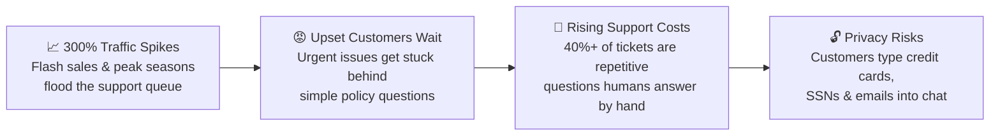
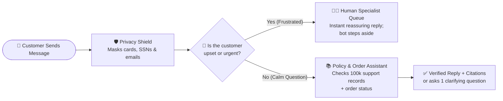
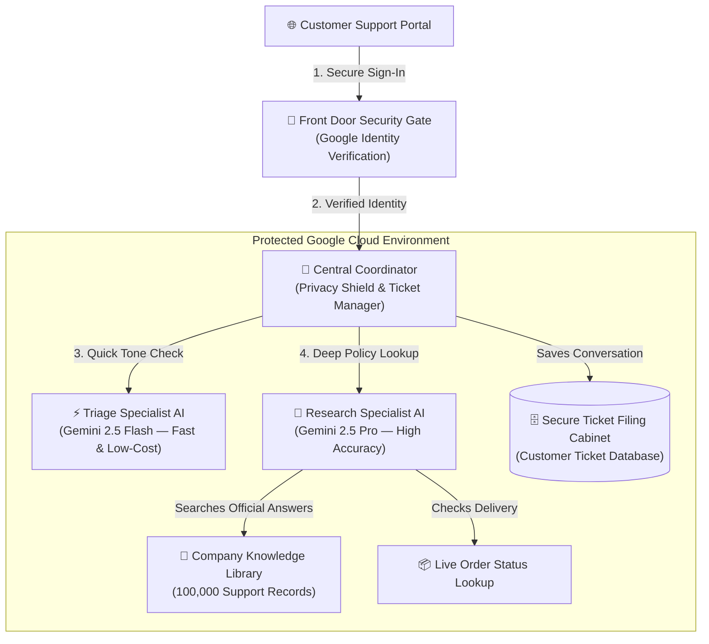
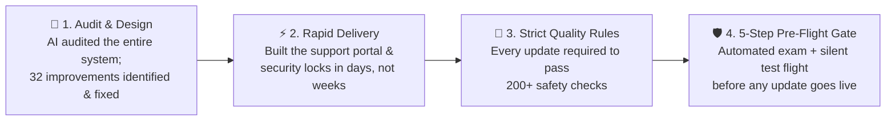

# Customer End-of-Build Presentation: Smart Support Router & Assistant

**Audience**: Executive Sponsors, Customer Experience (CX) Leaders & Support Operations Stakeholders  
**Format**: 7 Slides · ~10 Minutes Total Delivery (+ Plain-English Q&A Guide)  

> [!TIP]
> **10-Minute Pacing Guide**:
> - **Slide 1**: The Business Problem & What We Achieved *(1 min 15 sec)*
> - **Slide 2**: What the Product Does for Your Customers & Team *(1 min 30 sec)*
> - **Slide 3**: How It Works Behind the Scenes (The "Concierge" System) *(1 min 30 sec)*
> - **Slide 4**: Built-In Safety, Reliability & Quality Scorecard *(1 min 30 sec)*
> - **Slide 5**: Prototype Cost by System Module & Monthly Budget Projections *(1 min 30 sec)*
> - **Slide 6**: Key Design Decisions & Trade-offs We Navigated *(1 min 30 sec)*
> - **Slide 7**: How We Delivered Faster & Safer with AI-Assisted Delivery *(1 min 15 sec)*

---

## Slide 1: The Business Problem & Executive Summary
**⏱️ Duration: ~1 min 15 sec**

### Giving Every Customer Fast, Accurate Help—Without Burning Out Your Support Team

* **Four Challenges Facing Global Retail Hub**:
  1. **Upset Customers Wait in the Wrong Line**: When thousands of messages arrive at once, a frustrated customer with a missing or damaged order waits in the exact same queue as someone asking *"What is your return window?"*
  2. **Repetitive Questions Drain Your Best People**: Over **40%** of daily inquiries are routine policy or order-status questions that pull human specialists away from high-value problems.
  3. **Traditional Chatbots Break Under Pressure**: During peak holiday rushes, standard automated chatbots either freeze when overloaded or guess wrong answers, damaging customer trust.
  4. **Sensitive Customer Data in Chat**: Shoppers frequently type credit card numbers, Social Security Numbers, and personal emails directly into support chats, creating privacy risk.
* **What We Delivered**:
  * A **Smart Support Router & Assistant** that spots frustrated customers with **100% accuracy** to fast-track them to a human, answers routine questions using your official company records with **99.4% factual accuracy**, automatically masks private data, and costs **~1.2 cents per ticket all-in** based on our latest 100-ticket evaluation (**\$8.87 per 1,000 tickets** in direct AI & search usage, versus **\$5–\$15** for a human-handled ticket).

> [!NOTE]
> **Speaker Talk Track (Slide 1)**:
> *"Thank you everyone for joining today's end-of-build presentation. When we started this project, your team shared a clear challenge: during busy retail moments, ticket volume jumps 300%. Frustrated customers with urgent problems get stuck waiting behind routine questions, your human specialists spend nearly half their day answering repetitive FAQs, and customers often type sensitive credit card numbers right into the chat box. Over this build, we created a Smart Support Router and Assistant tailored for Global Retail Hub. In our 100-ticket test exam, it caught 100% of frustrated customers to fast-track them to a human specialist, answered routine questions with 99.4% factual accuracy from your official support records, and runs for roughly 1.2 cents per ticket all-in."*

---

## Slide 2: Product Capabilities & Customer Experience
**⏱️ Duration: ~1 min 30 sec**

### Five Everyday Capabilities That Protect Customers and Empower Agents

| Capability | What the Customer & Support Team Experience | Business Benefit |
| :--- | :--- | :--- |
| **1. Automatic Privacy Shield** | If a customer types a credit card number, SSN, or email address, the system automatically masks it (`[REDACTED]`) *before* the AI reads it or saves it to your records. | Zero sensitive personal numbers stored in chat history |
| **2. Instant Mood & Order Check** | Reads the tone of every message in ~2 seconds and pulls out key details (like Order Numbers or Product Names) so your team doesn't have to dig for them. | Instant triage & structured context for human agents |
| **3. Fast-Track to a Human Specialist** | When a customer is frustrated or urgent, the AI immediately steps aside, sends a reassuring message, and places the ticket in your **Human Escalation Queue**. | High-priority shoppers reach a person immediately |
| **4. Fact-Checked Answers & Order Lookup** | For routine questions, the AI searches **100,000 real support answers** and checks live order status. If a question is too vague (*"It's not working"*), it politely asks one clarifying question instead of guessing. | Accurate, first-contact resolution without made-up policies |
| **5. Transparent Support Workspace** | A clean web portal showing live ticket status, a **Source Citations Sidebar** proving which official policy record every answer came from, and one-click access to past conversations. | Full transparency for both customers and supervisors |

> [!NOTE]
> **Speaker Talk Track (Slide 2)**:
> *"Let's walk through what the product actually does when a customer reaches out. First, an Automatic Privacy Shield scrubs out credit card numbers, Social Security numbers, and emails before anything is saved or sent to the AI. Second, our Mood and Urgency Check reads the message: if the customer is frustrated, we don't force them to argue with a chatbot—the system immediately routes their ticket to a human specialist and pauses the AI even if the customer sends follow-up notes while waiting. Third, if it's a normal question, our Assistant checks your order system and searches 100,000 real past support records. If a customer asks something too vague—like 'I need help with my phone'—the AI is trained to ask one polite clarifying question rather than guessing. Finally, every AI answer is displayed alongside the exact source record it used in a clean web workspace."*

---

## Slide 3: How It Works Behind the Scenes (System Overview)
**⏱️ Duration: ~1 min 30 sec**

### Designed Like a Well-Run Hotel Concierge Desk

* **Why We Organized the Platform into Specialized Roles**:
  1. **The Front Door Security Gate**: Checks every visitor's sign-in credentials at the entrance so unauthorized users can never reach your internal systems.
  2. **The Central Coordinator**: Acts like a floor manager—scrubbing private data, keeping track of the ticket's status, and deciding which specialist should handle the message.
  3. **Two Specialized AI Brains Instead of One**:
     * **Triage Specialist (`Gemini 2.5 Flash`)**: Built for speed—reads every message in ~2.4 seconds to check if the customer is upset.
     * **Research Specialist (`Gemini 2.5 Pro`)**: Built for deep reading and accuracy—only called for calm questions that need policy research or order lookups (~7.1 seconds).
  4. **The Secure Ticket Filing Cabinet**: Remembers the entire conversation history so neither the customer nor your human agents ever lose context.

> [!NOTE]
> **Speaker Talk Track (Slide 3)**:
> *"To make the system fast, affordable, and easy to manage, we organized it like a well-run concierge desk. When a customer signs in at the Front Door Security Gate, their message goes to our Central Coordinator. Instead of using one giant, expensive AI brain for everything, we use two specialists. First, a fast, lightweight Triage AI checks the customer's mood in about two seconds. If they're upset, the Coordinator files the ticket straight to a human. Only when the question is calm and factual does the Coordinator bring in our Research Specialist AI, which looks up your 100,000 official support records and order tracker to craft a verified reply. Everything is saved in a secure filing cabinet so your team always sees the full story."*

---

## Slide 4: Safety, Reliability & Our Quality Scorecard
**⏱️ Duration: ~1 min 30 sec**

### Built for Holiday Traffic Spikes, Strict Privacy, and Zero Guessing

* **Three Built-In Safety Guarantees**:
  * **🔒 Private by Default**: Every customer can only view and manage their own tickets. Personal numbers are replaced with `[REDACTED]` before reaching the AI or storage.
  * **🔌 Automatic "Safety Fuse"**: Just like a safety breaker in your home—if the AI service ever slows down or hits a traffic limit during a major sale, our automatic safety fuse flips after 3 hiccups and smoothly sends new tickets straight to your human team in **under 0.01 seconds**, then automatically tests the AI every 30 seconds to turn itself back on.
  * **🤝 "When in Doubt, Ask a Human"**: If the AI cannot find an answer in your official records—or if anything looks unusual—it is trained to never guess. It politely hands the conversation to a human specialist.

* **Proven Results on Our 100-Ticket "Final Exam"**:

| What We Measured | Project Goal | Our Actual Score | What This Means for Your Business |
| :--- | :--- | :--- | :--- |
| **Overall Routing Accuracy** | `≥ 95%` | **99.0%** | 99 out of 100 tickets went to the exact right destination on the first try. |
| **Catching Upset Customers** | `≥ 95%` | **100.0%** | Every single frustrated customer in our test was immediately fast-tracked to a human. |
| **Factual Accuracy (No Made-Up Rules)** | `≥ 90%` | **99.4%** | The AI stuck strictly to your official policies without inventing rules or promises. |
| **Completeness of Answers** | `≥ 85%` | **88.7%** | Answers included the key policy steps customers needed to solve their issue. |
| **Match to Historical Human Replies** | `≥ 0.35` | **0.61** | Outperformed the target benchmark for matching real human agent responses. |
| **Handling Vague Questions** | `≥ 80%` | **80.0%** | Politely asked a clarifying question instead of guessing when prompts were unclear. |

> [!NOTE]
> **Speaker Talk Track (Slide 4)**:
> *"Beyond features, we know a support system has to be trustworthy on your busiest days. We built in three non-negotiable guardrails. First, strict privacy: customers can only ever access their own tickets, and personal numbers are scrubbed at the door. Second, an automatic Safety Fuse. If the AI ever gets overloaded during a holiday rush, the fuse flips after three hiccups and routes customers straight to your human team in less than a hundredth of a second, so no customer ever sees an error screen. Third, a 'never guess' rule that hands the ticket to a person whenever an answer isn't in your official records. We tested the system against 100 realistic support scenarios and beat every single goal—catching 100% of frustrated customers and achieving 99.4% factual accuracy."*

---

## Slide 5: Prototype Cost by System Module & Scaling Budget
**⏱️ Duration: ~1 min 30 sec**

### ~1.2 Cents per Ticket All-In (Latest 100-Ticket Evaluation) — >99% Less Than Manual Triage

* **1. Variable Cost Breakdown by System Module (Per 1,000 Tickets)**:
  * Based on our **latest 100-ticket evaluation** (110 customer messages across 5 ticket categories), automatic prompt caching (35% cached at a 90% discount) and concise AI responses brought actual variable cost **~6–8× below** initial pre-build estimates:

| System Module | Role in Customer Journey | Measured Eval Activity (per 100 tickets) | Cost per Active Call | **Cost per 1,000 Tickets** | Share of Variable Cost |
| :--- | :--- | :--- | :--- | :--- | :--- |
| **1. Policy & Order Research AI** (`Gemini 2.5 Pro`) | Reads official policy records & writes verified answers | 84 calls *(35% of input cached at 90% discount)* | `\$0.00889` / reply | **`\$7.47`** | **64.7%** |
| **2. Conversation Memory** *(Agent Session History)* | Remembers prior turns in multi-message tickets | 84 FAQ turns *(~6–7 memory events/turn)* | `\$0.00175` / turn | **`\$1.47`** | **12.7%** |
| **3. Knowledge Library Search** *(100,000 Support Records)* | Searches official company answers *(skipped when not needed)* | 75 searches *(standard search tier)* | `\$0.00150` / search | **`\$1.13`** | **9.8%** |
| **4. Active AI Server Compute** *(Agent Hosting)* | Cloud processing time while AI is actively thinking | ~9.0 active seconds per ticket | `\$0.00090` / ticket | **`\$0.90`** | **7.8%** |
| **5. Central Coordinator & Web Portal** | Manages tickets, web workspace & activity logs | 110 customer message turns | `\$0.00030` / ticket | **`\$0.30`** | **2.6%** |
| **6. Mood & Urgency Triage AI** (`Gemini 2.5 Flash`) | 2.4-second mood check + Order ID extraction | 109 triage checks | `\$0.00026` / check | **`\$0.28`** | **2.4%** |
| **7. Automatic Privacy Shield** *(Data Masking)* | Scrubs credit cards, SSNs & emails (`~169 ms`) | 110 messages scanned (`4` masked) | `< \$0.00001` / msg | **`\$0.01`** | **< 0.1%** |
| **Total All-In Variable Cost** | **All Runtime Modules Combined** *(Eval AI+Search = `\$8.87`)* | **100-Ticket Evaluation Mix** | **`~\$0.0116` / ticket** | **`\$11.55 / 1k tickets`** | **100%** |

* **2. Measured Evaluation Cost by Ticket Type (AI + Search)**:
  * **Urgent / Frustrated Escalation (`25%` of test)**: **`\$0.27` per 1,000 tickets** *(0.03¢/ticket — only runs Triage AI; skips Research AI & Search)*
  * **Vague Request Clarification (`15%` of test)**: **`\$8.10` per 1,000 tickets** *(0.81¢/ticket — asks 1 clarifying question; skips Search)*
  * **Order Status Lookup (`5%` of test)**: **`\$9.67` per 1,000 tickets** *(0.97¢/ticket — uses free internal Order Lookup tool)*
  * **Single-Turn Policy FAQ (`45%` of test)**: **`\$11.95` per 1,000 tickets** *(1.20¢/ticket — full Triage + Research AI + Search)*
  * **Multi-Turn Conversation (`10%` of test, 2 turns)**: **`\$17.32` per 1,000 tickets** *(1.73¢/ticket AI+Search; `~\$23/1k` all-in with cloud runtime)*

* **3. Fixed Monthly Base & Total Scaling Budget by Module**:
  * **Fixed Prototype Base (`\$29/mo`)**: Front Door Security Gate (`\$18.25/mo`) + Starter Ticket Database (`\$9.37/mo`) + Cloud Storage (`\$1.50/mo`).
  * **Fixed 24/7 Enterprise Base (`\$230/mo`)**: Upgrades Ticket Database to 24/7 High-Availability with automatic failover backups (`\$197/mo`) + Security Gate (`\$18.25/mo`) + 1 Always-Awake Coordinator Server (`\$13.50/mo`) + Storage (`\$1.50/mo`).

| Stage & Monthly Volume | Fixed Monthly Base | Variable Cost *(Latest Eval Mix: `\$11.55/1k`)* | **Expected Monthly Total (Latest Eval)** | Conservative Ceiling *(Heavy 3-Turn Mix: `\$75/1k`)* |
| :--- | :--- | :--- | :--- | :--- |
| **Pilot (1,000 tickets / mo)** | `\$29 / mo` *(Prototype)* | `\$12 / mo` | **`~\$41 / month`** | `~\$105 / month` |
| **Initial Launch (10,000 tickets / mo)** | `\$29 / mo` *(Prototype)* | `\$116 / mo` | **`~\$145 / month`** | `~\$780 / month` |
| **Enterprise Scale (100,000 tickets / mo)** | `\$230 / mo` *(24/7 Enterprise)* | `\$1,155 / mo` | **`~\$1,385 / month`** | `~\$7,730 / month` |

> [!NOTE]
> **Speaker Talk Track (Slide 5)**:
> *"Let's look at exactly what the platform costs by module, based on our latest 100-ticket evaluation. A typical human-handled retail ticket costs \$5 to \$15. Before we ran our evaluation, we budgeted a conservative ceiling of 7.5 cents per ticket. However, in our actual 100-ticket evaluation, automatic prompt caching and concise AI responses brought our measured AI and search cost down to just \$8.87 per 1,000 tickets—or \$11.55 per 1,000 tickets (about 1.2 cents per ticket) when you include every live cloud module. Looking module by module: about 65% goes to our Research Specialist AI, 13% to Conversation Memory, 10% to Knowledge Library Search, 8% to active AI server time, and under 3% each to our Central Coordinator and Fast Triage AI, while our Privacy Shield costs less than a penny per thousand tickets. Urgent tickets cost just 0.03 cents because they skip the Research AI entirely. Combined with our \$29-a-month prototype base, a 1,000-ticket pilot costs about \$41 a month, and even 100,000 tickets on a 24/7 backup-protected enterprise database runs around \$1,385 a month."*

---

## Slide 6: Key Design Decisions & Trade-offs We Navigated
**⏱️ Duration: ~1 min 30 sec**

### Balancing Cost, Speed, Privacy & Customer Experience

| Decision We Faced | What We Chose | What We Traded Off & Why It Was the Right Call |
| :--- | :--- | :--- |
| **1. One Big AI Brain vs. Two Specialists** | **Two Specialists**: Fast Triage AI (`Flash`) + Deep Research AI (`Pro`) | **Saved 97% on Urgent Tickets**: Using a smaller, faster AI for the initial mood check costs `$0.00026` vs. `$0.00889` for the Research AI—keeping urgent tickets fast and inexpensive while preserving **99.4% accuracy** on policy answers. |
| **2. Prototype Hosting vs. Day-1 Enterprise Servers** | **On-Demand Servers + Starter Database (`\$29/mo`)** for the build | **Saved >\$200/mo During Build**: Instead of paying `\$230+/month` for heavy 24/7 servers during development, we used servers that sleep when idle (accepting a brief ~2-second warm-up after quiet hours) and made upgrading to an enterprise database a simple switch. |
| **3. When to Scrub Customer Privacy Data** | **Scrub at the Front Door** (*before* saving to storage) | **Maximum Privacy Compliance**: By masking credit cards, SSNs, and emails immediately (`~169 ms`), your support database can **never leak sensitive numbers**—trading away raw card/email visibility in chat text for complete peace of mind. |
| **4. How to Handle Vague Questions** | **Ask 1 Clarifying Question First** instead of guessing right away | **Accuracy & Search Savings**: When a customer simply writes *"Help, it's broken,"* asking one polite follow-up question adds one extra message, but prevents wrong answers and saves the `\$1.50/1k` search fee on blind queries. |
| **5. Conversation Memory Design** | **Full Memory for Policy Answers**, **Clean Slate for Mood Checks** | **Natural Chat Without Spillover**: The policy assistant remembers previous turns so customers don't repeat themselves, while the mood checker starts fresh every time so one ticket's frustration never spills into another. |

> [!NOTE]
> **Speaker Talk Track (Slide 6)**:
> *"Every project involves practical trade-offs, and we want to share the five biggest decisions we made on your behalf. First, instead of running our deeper Research AI model on every single message, we paired a fast, low-cost Triage model with the Research model—making urgent escalations 34 times cheaper while keeping 99.4% accuracy on policy answers. Second, we chose on-demand servers and a starter database to keep your prototype bill at \$29 a month, while designing the platform so we can flip a switch to a 24/7 backup database when you launch. Third, we decided to mask credit cards and emails before saving messages to storage, trading away raw text in logs for ironclad privacy protection. Fourth, we trained the AI to ask one clarifying question when a customer is vague rather than guessing or running a blind search. And fifth, we gave the policy assistant full conversation memory while keeping the mood-checker fresh on every turn."*

---

## Slide 7: How We Built It Faster & Safer with AI-Assisted Delivery
**⏱️ Duration: ~1 min 15 sec**

### "AI Accelerates the Heavy Lifting, Humans Own the Decisions & Quality"

* **How We Used AI to Deliver Your Platform Faster *and* Safer**:
  1. **32-Point Automated Security & Quality Inspection**: We partnered with Google's AI assistant to inspect the entire system like a tireless independent auditor—identifying and completing **32 improvements** across security, privacy, and reliability before launch review.
  2. **Weeks of Work Delivered in Days**: Using AI-assisted design and delivery, we built the modern customer support workspace, integrated the 100,000-record knowledge library, and configured enterprise sign-in in days rather than weeks.
  3. **Strict Quality Standards on Every Change**: We never let AI make unchecked changes. Every update was required to pass **200+ automated safety checks** and our **100-ticket quality exam** before being approved by our human team.
  4. **A 5-Step Automated "Pre-Flight Checklist" Before Any Update Goes Live**:
     * **Step 1**: **200+ Automated Safety & Privacy Checks** verify data masking, customer isolation, and the safety fuse.
     * **Step 2**: **The 100-Ticket "Final Exam"** graded by an independent AI reviewer for accuracy and completeness.
     * **Step 3**: **Practice System Startup Check** confirms all platform components start cleanly together.
     * **Step 4**: **Live AI Health Verification** checks both AI specialists, with **automatic rollback** if anything misbehaves.
     * **Step 5**: **Silent "Test Flight"** tests a realistic end-to-end customer conversation on a hidden preview version before switching live shoppers over.

> [!NOTE]
> **Speaker Talk Track (Slide 7)**:
> *"Finally, we want to share how we built and verified so much in such a short window. We used an AI-Driven Delivery approach guided by a simple rule: 'AI does the heavy lifting, and humans verify and approve.' We used AI to conduct a 32-point security and quality audit, build the support workspace, and run over 200 automated safety checks. More importantly, we put strict guardrails in place: every single update has to pass a 5-step automated pre-flight checklist—including our 100-ticket final exam and a silent 'test flight' on a hidden preview server—before it ever reaches your customers. If any step falls short, the system automatically rolls back to the last safe version. Thank you—we'd love to open the floor for your questions!"*

---

## Appendix: Plain-English Q&A Guide for Customer Questions

> [!IMPORTANT]
> Quick, jargon-free answers for common executive questions on **cost**, **speed**, and **next steps**.

1. **"Why did the cost per 1,000 tickets drop from your initial \$75 estimate down to \$11.55 (\$8.87 in AI & Search)?"**
   * **Plain-English Answer**: *"Before we ran the 100-ticket evaluation, our \$75-per-1,000-tickets estimate was a conservative budget ceiling assuming long 2,000-word AI thoughts and zero caching. When we ran the actual 100-ticket evaluation, three real-world efficiencies kicked in: (1) Google's automatic context caching discounted 35% of our Research AI input tokens by 90%, (2) our Research AI needed 7 times fewer output tokens than estimated to write clear answers, and (3) urgent, order-lookup, and vague-question turns automatically skipped paid knowledge searches. That brought the measured AI & Search cost to **\$8.87 per 1,000 tickets** (**\$11.55 per 1,000 tickets all-in** with cloud hosting and memory)."*
2. **"Can we make the Research AI module even faster and cheaper?"**
   * **Plain-English Answer**: *"Yes! Even at \$7.47 per 1,000 tickets, the `Gemini 2.5 Pro` Research AI accounts for 65% of variable cost and takes about 7 seconds per answer. If we switch the Research AI to `Gemini 2.5 Flash`, that module's cost drops by ~75% (bringing all-in cost under **\$5 per 1,000 tickets**) and response time drops from ~7 seconds to ~3 seconds. Because we have the 100-ticket automated exam, we can test that switch in 15 minutes and verify that accuracy stays above your 85% target."*
3. **"What happens if the AI doesn't know the answer to a new product or policy?"**
   * **Plain-English Answer**: *"Two things: First, if the answer isn't in your knowledge library today, the AI is strictly trained not to guess—it tells the customer it couldn't find a documented policy and transfers them to a human specialist. Second, adding new policies doesn't require rebuilding the system; we simply upload the updated policy documents into the Knowledge Library and the AI immediately starts citing them."*
