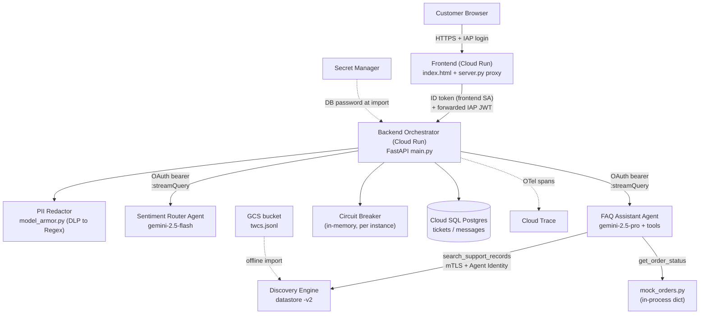
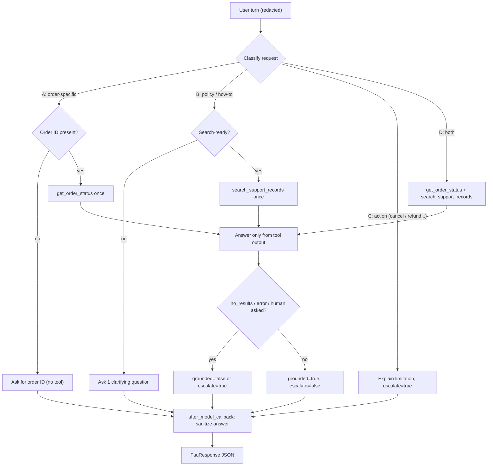
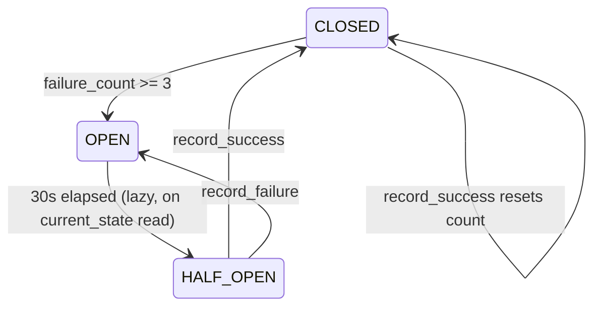
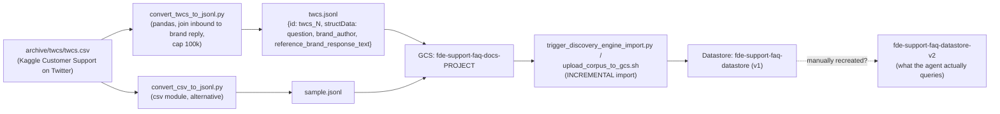

# FDE Support Platform: System Analysis, Module Workflows & Recommendations

> [!NOTE]
> The original analysis was a static read of the working tree on 2026-10-18.
> **Updated 2026-10-19:** every recommendation was re-checked against the code and marked with a status (see §0). Sections 1–3 now describe the current code. Where the old behaviour matters, it is kept as a struck-through note.
> The test suite now runs locally: **178/178 pass** (see §5.4).

---

## 0. Remediation Status (as of 2026-10-19)

**Legend:** ✅ Resolved in code · 🟡 Partially resolved · ⬜ Open

> [!IMPORTANT]
> "Resolved" means resolved **in the working tree**. Nothing below is deployed yet.
> - **Backend and frontend:** must be deployed together (the identity contract changed). The backend needs `IAP_AUDIENCE` and `FRONTEND_SERVICE_ACCOUNT`.
> - **Sentiment agent:** needs a redeploy to pick up the output schema (#6).
> - **IAM:** `scripts/setup_identities.sh` still has to be run (#16).
> - **Git:** the quick-win deletions (#1, #19) are staged, not committed.

| Priority | ✅ Resolved | 🟡 Partial | ⬜ Open |
|---|---|---|---|
| 🔴 P0 (1–6) | 1, 2, 3, 4, 5, 6 | none | none |
| 🟠 P1 (7–13) | 11, 12, 13 | 7, 8 | 9, 10 |
| 🟡 P2 (14–21) | none | 16, 19 | 14, 15, 17, 18, 20, 21 |
| 🔵 P3 (22–30) | none | 25, 26 | 22, 23, 24, 27, 28, 29, 30 |

**Changes beyond the original list:**
- **CSRF protection:** a Fetch Metadata guard in the frontend (`Sec-Fetch-Site`, falling back to `Origin`) blocks cross-site POSTs.
- **Backend verifies the IAP JWT itself:** the frontend forwards the user's IAP assertion, and the backend accepts it only from the frontend service account ([caller_identity.py](file:///Users/jiahaoliu/ws/fde_support/backend/caller_identity.py)).
- **FAQ agent memory cleanup:** the FAQ agent session is deleted when a ticket is resolved. Sentiment sessions are deleted at the end of every run.

---

## 1. System Overview

The system is an AI customer-support platform on GCP with **5 runtime components** and **2 offline pipelines**:

| # | Component | Runtime | Main files |
|---|-----------|---------|------------|
| 1 | Web UI + Proxy | Cloud Run (`fde-support-frontend`, behind IAP) | [index.html](file:///Users/jiahaoliu/ws/fde_support/frontend/index.html), [server.py](file:///Users/jiahaoliu/ws/fde_support/frontend/server.py) |
| 2 | Orchestrator Backend | Cloud Run (`fde-support-backend`, private) | [main.py](file:///Users/jiahaoliu/ws/fde_support/backend/main.py), [config.py](file:///Users/jiahaoliu/ws/fde_support/backend/config.py), [circuit_breaker.py](file:///Users/jiahaoliu/ws/fde_support/backend/circuit_breaker.py), [model_armor.py](file:///Users/jiahaoliu/ws/fde_support/backend/model_armor.py) |
| 3 | Sentiment Router Agent | Vertex AI Agent Runtime (Reasoning Engine `7184…7456`) | [agent.py](file:///Users/jiahaoliu/ws/fde_support/agents/sentiment_router/agent.py) |
| 4 | FAQ Assistant Agent | Vertex AI Agent Runtime (Reasoning Engine `6767…2953`, Agent Identity) | [agent.py](file:///Users/jiahaoliu/ws/fde_support/agents/faq_assistant/agent.py), [tools.py](file:///Users/jiahaoliu/ws/fde_support/agents/faq_assistant/tools.py), [mock_orders.py](file:///Users/jiahaoliu/ws/fde_support/agents/faq_assistant/mock_orders.py), [answer_sanitizer.py](file:///Users/jiahaoliu/ws/fde_support/agents/faq_assistant/answer_sanitizer.py) |
| 5 | Ticket Store | Cloud SQL Postgres 15 (`db-f1-micro`); SQLite only for local dev (refused in production) | [db.py](file:///Users/jiahaoliu/ws/fde_support/database/db.py), [models.py](file:///Users/jiahaoliu/ws/fde_support/database/models.py) |
| P1 | Knowledge-base ingestion | Offline scripts → GCS → Discovery Engine | [convert_twcs_to_jsonl.py](file:///Users/jiahaoliu/ws/fde_support/scripts/convert_twcs_to_jsonl.py), [trigger_discovery_engine_import.py](file:///Users/jiahaoliu/ws/fde_support/scripts/trigger_discovery_engine_import.py) |
| P2 | Build & deploy | Cloud Build, `gcloud run deploy`, `agents-cli deploy`, Terraform | `*/deploy.sh`, `cloudbuild*.yaml`, [deployment/terraform](file:///Users/jiahaoliu/ws/fde_support/deployment/terraform) |



---

## 2. End-to-End Request Workflow (`POST /api/chat`)

```mermaid
sequenceDiagram
    autonumber
    participant B as Browser
    participant F as Frontend proxy
    participant K as Backend
    participant S as Sentiment Agent
    participant D as Cloud SQL
    participant Q as FAQ Agent
    participant T as Tools

    B->>F: POST /api/chat {message, session_id?}
    F->>F: CSRF guard (Sec-Fetch-Site), verify IAP JWT (fail closed)
    F->>F: Get cached ID token for backend audience
    F->>K: Forward body + Bearer ID token + IAP JWT (no X-User-Email)
    K->>K: Resolve caller from IAP JWT (only from frontend SA)
    K->>D: Ownership check on session_id (404 if not caller's); else new UUID
    K->>K: Step 0: PII redaction (DLP if available, then regex)
    alt ticket already ESCALATED
        K->>D: insert CUSTOMER msg (no LLM call)
        K-->>B: "a specialist will reply" ack
    end
    K->>S: Step 1: stream_query (fresh session s-uuid, deleted after run)
    S-->>K: NDJSON, schema-constrained JSON {sentiment, order_id, product_name, email}
    K->>D: Step 2: Load/create ticket (owned by caller), insert CUSTOMER msg
    alt URGENT_FRUSTRATED / sentiment failed / unusable label
        K->>D: status=ESCALATED, insert SYSTEM msg
        K-->>B: calming ack, routed_to = Human Escalation Queue
    else Circuit OPEN
        K->>D: status=ESCALATED, insert SYSTEM msg
        K-->>B: outage fallback
    else Circuit CLOSED (up to 3 tries, 5s apart) / HALF_OPEN (1 probe)
        K->>Q: Step 5: stream_query (session = ticket id)
        Q->>T: get_order_status / search_support_records
        T-->>Q: tool results
        Q-->>K: NDJSON, FaqResponse JSON {answer, citations, grounded, escalate}
        K->>K: Parse NDJSON, parse nested JSON, sanitize_answer, format_citations
        K->>D: insert AGENT msg; ESCALATED if escalate=true (incl. soft fallbacks)
        K-->>B: answer + citations + status
    end
```

### Ticket state machine

```mermaid
stateDiagram-v2
    [*] --> NEW: POST /api/tickets/create (server-generated UUID)
    NEW --> IN_PROGRESS: first neutral chat
    [*] --> IN_PROGRESS: chat without session_id (server-generated UUID)
    [*] --> ESCALATED: first chat urgent / sentiment down
    NEW --> ESCALATED: urgent / sentiment failed / CB open / FAQ failed / escalate=true
    IN_PROGRESS --> ESCALATED: same triggers
    ESCALATED --> ESCALATED: follow-ups queued for the human (no LLM call)
    NEW --> RESOLVED: POST /resolve (owner only)
    IN_PROGRESS --> RESOLVED: POST /resolve (owner only)
    ESCALATED --> RESOLVED: POST /resolve (owner only)
    RESOLVED --> [*]: further chats rejected (400); FAQ agent session deleted
```



---

## 3. Module-by-Module Workflows

### 3.1 Frontend: UI ([index.html](file:///Users/jiahaoliu/ws/fde_support/frontend/index.html))

**What it does:** a single-page chat portal (vanilla JS) with a ticket badge, citation sidebar, and resolve / new-ticket controls.

1. **Boot (`initUI`)**
   - `GET /api/user/me` returns the verified IAP email (display only).
   - `POST /api/tickets/create` with an empty body. The **server** generates the ticket UUID, which becomes `currentSessionId`. ~~Previously the client generated `'ticket_' + Math.random()…`.~~
   - `setInterval(checkStatus, 5000)` polls `GET /api/status` to drive the online/offline dot.
2. **Send (`sendQuery`)**
   - Render the user bubble (escaped), then an interim "Processing…" card.
   - `POST /api/chat` with `{message, session_id?}`. No `customer_id` is sent; identity comes from IAP.
   - On 400 with "RESOLVED": alert and lock the chat.
   - Otherwise: update the badge, render the sentiment tag, route tag, entities, and answer, and replace the citations sidebar. The UI re-parses `answer` if it still looks like JSON.
3. **Resolve (`resolveTicket`)**: `POST /api/tickets/{id}/resolve`, then lock the UI.
4. **New ticket (`startNewTicket`)**: new random ID, clear the UI, `POST /api/tickets/create`.
5. **Sign out**: redirect to `/_gcp_iap/clear_login_cookie`.

### 3.2 Frontend: Proxy server ([server.py](file:///Users/jiahaoliu/ws/fde_support/frontend/server.py))

1. **No CORS middleware.** A `reject_cross_site_requests` middleware returns 403 for non-GET requests whose `Sec-Fetch-Site` isn't `same-origin` or `none`. Older browsers fall back to an `Origin` check. Non-browser clients are allowed but still need IAP.
2. `GET /` and `/index.html` serve the HTML with no-cache headers. Non-`/api` 404s also return the SPA.
3. `GET /api/user/me` returns the email from the **verified** `x-goog-iap-jwt-assertion` ([common/iap_auth.py](file:///Users/jiahaoliu/ws/fde_support/common/iap_auth.py): ES256, audience, issuer, expiry). Any failure returns 401; there is no demo fallback.
4. `/api/{path}` is a catch-all reverse proxy to `CLOUD_RUN_BACKEND_URL`:
   - It verifies the IAP JWT **before** doing any upstream work.
   - `get_id_token()` is **cached per audience** until 5 minutes before `exp`. On a miss it tries `google.oauth2.id_token`, then the metadata server, then the `gcloud` CLI.
   - It builds upstream headers from scratch: `Accept`, `Content-Type`, `Authorization`, and the forwarded IAP assertion. Client `X-User-Email` is never forwarded.
   - The body is forwarded unchanged. The backend ignores identity fields in it.
   - Uses a 120 s httpx timeout. Hop-by-hop headers are stripped from the response.

### 3.3 Backend Orchestrator ([main.py](file:///Users/jiahaoliu/ws/fde_support/backend/main.py))

**Startup (import time):**
1. `Settings()` loads env / `.env`.
2. `database.db` import calls `settings.get_database_url()`. Production means `ENV=production` **or** running on Cloud Run (`K_SERVICE` set):
   - **Production:** requires `DB_PASSWORD` (mounted from Secret Manager with `--set-secrets`) and `CLOUD_SQL_CONNECTION_NAME`, and connects over the Cloud SQL Unix socket. An explicit `DATABASE_URL` is allowed but can't be SQLite. Anything missing raises `DatabaseConfigError`. There is no runtime SDK/`gcloud` lookup and no SQLite fallback (✅ #5).
   - **Development:** uses `DATABASE_URL`, else `DB_PASSWORD` or a Secret Manager/`gcloud` lookup through the Auth Proxy on `127.0.0.1:5432`, else SQLite with a logged warning.
   - URLs are built with `sqlalchemy.URL.create` (passwords are escaped), and logs only show the masked URL.
3. `init_db()` runs `Base.metadata.create_all`.
4. The circuit breaker is created (threshold 3, recovery 30 s).
5. The caller resolver is built from `IAP_AUDIENCE`, `FRONTEND_SERVICE_ACCOUNT`, and `ALLOW_DIRECT_CALLERS` ([caller_identity.py](file:///Users/jiahaoliu/ws/fde_support/backend/caller_identity.py)). There is no CORS middleware.
6. OTel is set up: TracerProvider, Cloud Trace exporter, FastAPI and httpx auto-instrumentation.

**Endpoints:**

Every `/api/*` endpoint resolves the caller with `Depends(get_caller)`. A caller that can't be authenticated gets 401.

| Endpoint | Behaviour |
|---|---|
| `GET /health` | Static health info + breaker state (DB status is hard-coded "connected") |
| `GET /api/status` | Breaker state + failure count + agent URLs (⬜ #18: still exposes URLs) |
| `POST /api/chat` | Main pipeline (§2) |
| `POST /api/tickets/create` | Insert a NEW ticket with a **server-generated UUID**, owned by the caller |
| `POST /api/tickets/{id}/resolve` | Owner only (**404** if unknown or not the caller's). Sets RESOLVED + SYSTEM msg and deletes the FAQ agent session |
| `GET /api/tickets/{id}` | Owner only (**404** otherwise). Ticket + full message transcript |

**`/api/chat` pipeline:**
1. **Validate**: reject an empty message with 400.
2. **Authorize**: if `session_id` is set, it must be the caller's ticket (404 otherwise; 400 if RESOLVED). If not set, the server generates a UUID. `customer_id` is always the caller.
3. **Redact**: `model_armor.redact()` (span `model_armor_redact`).
4. **Escalated short-circuit**: if the ticket is ESCALATED, store the message for the human and return an ack, with no LLM call.
5. **Classify**: `call_sentiment_agent()`.
   - An outage or HTTP error sets `sentiment_failed` and calls `record_failure(503)`.
   - An unparseable output or unknown label (`SentimentClassificationError`) sets `sentiment_failed` without touching the breaker.
   - Both cases fail closed (escalate).
6. **Persist**: load or create the ticket (filtered by `customer_id == caller`).
   - RESOLVED ticket: return 400.
   - `is_urgent` (URGENT_FRUSTRATED or sentiment failed): ESCALATED.
   - NEW: IN_PROGRESS.
   - Insert the CUSTOMER message.
7. **Human route**: `is_urgent` means a canned ack, a SYSTEM message, and an early return.
8. **Breaker gate**: OPEN means outage fallback, ESCALATED, and an early return.
9. **FAQ call** (session `t-<ticket uuid>`, user `agent_user_id(caller)`):
   - HALF_OPEN: 1 probe.
   - CLOSED: up to 3 attempts with `sleep(5)` between them. Every failed attempt except a 400/422 is counted on the breaker.
10. **All attempts failed**: outage fallback, ESCALATED.
11. **Post-process the answer**:
    - Unwrap a fenced/nested JSON answer (regex fallback).
    - Merge citations and pick up `grounded` / `escalate`.
    - Run `sanitize_answer()` (defence in depth).
12. **Persist the answer**: AGENT message. `escalate=true` sets ESCALATED.
13. **Respond**: `format_citations()` and return `SupportQueryResponse`.

**Agent client helpers:**
- `get_gcp_auth_headers()`: ADC credentials are loaded **once** (module-level, behind a lock) and refreshed only when `not credentials.valid`. ~~Previously it called `refresh()` on every call.~~
- `parse_ndjson_stream()`:
  - Walks the NDJSON events and skips `thought` parts.
  - Keeps the **last** non-empty text event.
  - Collects citations from `function_response` (doc IDs, order IDs) and `grounding_metadata`.
- `call_sentiment_agent()`: sends a fresh `s-<uuid>` session each time and validates the label against `SENTIMENT_LABELS`. Anything else raises `SentimentClassificationError`.
- `call_faq_agent()`: a 200 with empty text, or a 4xx/5xx body saying "thought-only", becomes a soft fallback with `grounded=False` and **`escalate=True`** (✅ #11).
- `delete_faq_session()`: best-effort `async_delete_session` on resolve. It never raises.

### 3.4 PII Redaction ([model_armor.py](file:///Users/jiahaoliu/ws/fde_support/backend/model_armor.py))

1. If `google.cloud.dlp` imports, try DLP `deidentify_content` for CREDIT_CARD / SSN / EMAIL, replacing each with its info-type.
2. **Always** run regex afterwards:
   - Known card prefixes.
   - A generic 13–19 digit run.
   - SSN `###-##-####`.
   - Email.
3. The redacted text replaces `request.message`, so it is used for **both the LLM and the DB**. Raw PII is never stored, which is good.

> [!WARNING]
> `google-cloud-dlp` is **not** in [backend/requirements.txt](file:///Users/jiahaoliu/ws/fde_support/backend/requirements.txt), so production only uses regex.
> The Terraform-provisioned Model Armor template (`support-router-pii-masking`) is **never called**.
> The "Model Armor" in the code name and in the presentation is really DLP + regex.

### 3.5 Sentiment Router Agent ([agent.py](file:///Users/jiahaoliu/ws/fde_support/agents/sentiment_router/agent.py))

1. Deployed with `agents-cli deploy -d agent_runtime --agent-identity`. Exposed as an ADK `App` (`sentiment_router_app`).
2. Model: `gemini-2.5-flash` with **`output_schema=SentimentResult`**. The `sentiment` field is `Literal["URGENT_FRUSTRATED","NEUTRAL_FACTUAL"]`, so constrained decoding can't produce other labels. ~~Previously only `response_mime_type=application/json`, with no enum.~~
3. The prompt classifies into `URGENT_FRUSTRATED` or `NEUTRAL_FACTUAL` and extracts `order_id`, `product_name`, `email`.
4. The backend sends `user_id="sentiment_classifier"` and a **fresh `s-<uuid>` session per message**. The agent's session service deletes the session after the run ([app_utils/services.py](file:///Users/jiahaoliu/ws/fde_support/agents/sentiment_router/app_utils/services.py)). ~~Previously one shared `sentiment_session` was used for every customer.~~
5. The backend strips code fences, calls `json.loads`, and checks the label. A parse failure or unknown label **escalates to a human** (fail closed). ~~Previously it defaulted to NEUTRAL_FACTUAL.~~
6. `analyze_ticket_sentiment()` is a local-only helper and is not used by the deployed path (⬜ #23).

### 3.6 FAQ Assistant Agent ([agent.py](file:///Users/jiahaoliu/ws/fde_support/agents/faq_assistant/agent.py), [tools.py](file:///Users/jiahaoliu/ws/fde_support/agents/faq_assistant/tools.py))

**Agent loop** (`gemini-2.5-pro`, `output_schema=FaqResponse`, `after_model_callback=sanitize_model_response`):



**`search_support_records(query, top_k)` workflow:**
1. Validate the query and trim it to 500 chars. Clamp `top_k` to 1–10.
2. `_get_search_client()`:
   - If `GOOGLE_API_CERTIFICATE_CONFIG` points to a usable workload cert (Agent Identity): force `GOOGLE_API_USE_CLIENT_CERTIFICATE=true`, use the **mTLS endpoint** with the REST transport, and re-read the cert on every call to handle rotation.
   - Otherwise: the default endpoint with `quota_project_id`.
3. Call `SearchRequest(serving_config=…/default_search)` with a 12 s timeout, using `islice` to take k results.
4. Map errors to safe codes: `rate_limited`, `auth_error`, `permission_denied`, `search_unavailable`. Details go to the log only.
5. Map each hit to `{doc_id, brand, customer_question, brand_response}`, truncated to 300 chars.

**`get_order_status(order_id)` workflow:**
1. `normalize_order_id` accepts `#12345`, `ORD-12345`, `12345`, and similar, and canonicalises to `#12345`.
2. Look up the in-process `MOCK_ORDERS` dict (a deep copy). Returns `found`, `not_found`, or `invalid_order_id`.

**Answer sanitizer ([answer_sanitizer.py](file:///Users/jiahaoliu/ws/fde_support/agents/faq_assistant/answer_sanitizer.py))**, stdlib-only and shared by the agent and the backend. It removes, in order:
1. Bracketed `twcs_*` doc-ID groups.
2. Labelled or bare doc IDs.
3. Empty brackets.
4. Datastore resource paths.
5. Tool names.
6. Leading attribution clauses ("Based on our support records, …"), recapitalising the next word.
7. Backend nouns, replaced with "our support resources".
8. Then it tidies whitespace and punctuation.

It runs **twice**: in the agent's `after_model_callback` and again in the backend.

### 3.7 Circuit Breaker ([circuit_breaker.py](file:///Users/jiahaoliu/ws/fde_support/backend/circuit_breaker.py))



- Lives in process memory, so each Cloud Run instance has its own breaker.
- There is no lock and no single-probe gating in HALF_OPEN, so every concurrent request in that window acts as a probe.
- Failures are counted per **attempt**, not per request.
- Sentiment-agent **outages** still count against this (FAQ) breaker. Bad sentiment *classifications* no longer do.

### 3.8 Persistence ([db.py](file:///Users/jiahaoliu/ws/fde_support/database/db.py), [models.py](file:///Users/jiahaoliu/ws/fde_support/database/models.py))

- **`tickets`** table:
  - `id` is a String(36) primary key holding a **server-generated UUID4**. It is returned to the UI as `ticket_id`/`session_id`.
  - `customer_id`, `current_status`, `sentiment`, `created_at`.
- **`messages`** table: `id` UUID, `ticket_id` foreign key, `sender` (CUSTOMER / AGENT / SYSTEM), `message_text`, `created_at`.
- Uses sync SQLAlchemy. The pool is 5 + 10 overflow. `pool_pre_ping` is on.
- Schema management is mixed across three mechanisms:
  - ORM `create_all`.
  - [schema.sql](file:///Users/jiahaoliu/ws/fde_support/database/schema.sql) (UUID types), uploaded by Terraform but never applied.
  - [init_db.py](file:///Users/jiahaoliu/ws/fde_support/database/init_db.py) (raw SQLite DDL).
  - The ORM uses `String(36)` while `schema.sql` uses `UUID`. New ticket IDs are now real UUIDs, so they would fit. Legacy `ticket_…` rows created before the change would not.

### 3.9 Knowledge-Base Ingestion Pipeline (offline)



### 3.10 Build, Deploy & Infrastructure

| Path | Steps |
|---|---|
| **Backend** | [backend/deploy.sh](file:///Users/jiahaoliu/ws/fde_support/backend/deploy.sh): `gcloud builds submit --config=backend/cloudbuild.yaml` (build, a `gcloud run deploy` step, then push) → `gcloud run deploy --service-account=backend-sa --no-allow-unauthenticated` |
| **Frontend** | [frontend/deploy.sh](file:///Users/jiahaoliu/ws/fde_support/frontend/deploy.sh): `gcloud builds submit --config=cloudbuild-frontend.yaml` (build + push) → `gcloud run deploy --service-account=frontend-sa` |
| **Agents** | `agents/*/deploy.sh`: `agents-cli deploy -d agent_runtime --agent-identity` → writes `deployment_metadata.json` |
| **Identities** | [setup_identities.sh](file:///Users/jiahaoliu/ws/fde_support/scripts/setup_identities.sh): creates the 2 SAs. Backend gets `cloudsql.client`, `aiplatform.user`, `secretAccessor`. Frontend gets `run.invoker` **on the backend service only**. The script also removes the legacy project-wide grant and the default compute SA's invoker binding. **Not yet run against the project.** |
| **Terraform** | Enables APIs, creates the AR repo, GCS bucket, Discovery Engine datastore (v1), Cloud SQL instance + DB, and Model Armor template, plus Cloud Build IAM. **Not in Terraform:** Cloud Run services, SAs, secrets, IAP binding, Agent Engines, datastore v2, VPC-SC. |

### 3.11 Observability

- **Backend:**
  - Custom spans: `model_armor_redact`, `call_sentiment_agent_runtime`, `cloud_sql_sync_ticket`, `circuit_breaker_check`, `call_faq_agent_runtime`, `cloud_sql_record_*`.
  - FastAPI and httpx auto-instrumentation propagate `traceparent` to the agents.
- **Agents:**
  - ADK telemetry is on (`GOOGLE_CLOUD_AGENT_ENGINE_ENABLE_TELEMETRY`).
  - **Prompt and response content capture** is on (`SPAN_AND_EVENT`).
  - `tools.py` logs the auth mode once per process.

### 3.12 Tests ([tests/](file:///Users/jiahaoliu/ws/fde_support/tests))

- 18 test files, **178 tests, all passing**. Coverage:
  - Backend routing (agents mocked).
  - Circuit breaker behaviour and integration.
  - Resilience (retries, sentiment offline).
  - DB persistence and escalated-ticket follow-ups.
  - Sanitizer and FAQ tools, including `parse_ndjson_stream`.
  - **IAP JWT verification:** [test_iap_auth.py](file:///Users/jiahaoliu/ws/fde_support/tests/test_iap_auth.py).
  - **Backend caller identity:** [test_backend_identity.py](file:///Users/jiahaoliu/ws/fde_support/tests/test_backend_identity.py).
  - **Authorization:** ownership/IDOR, forged headers, CORS/CSRF ([test_authz.py](file:///Users/jiahaoliu/ws/fde_support/tests/test_authz.py)).
  - **Agent session isolation:** [test_agent_sessions.py](file:///Users/jiahaoliu/ws/fde_support/tests/test_agent_sessions.py).
  - **Quick wins:** sentiment schema, fail-closed routing, token caches ([test_quick_wins.py](file:///Users/jiahaoliu/ws/fde_support/tests/test_quick_wins.py)).
- **Offline eval assets:** [golden_set_v1.json](file:///Users/jiahaoliu/ws/fde_support/tests/eval/golden/golden_set_v1.json) and [static_rubric_evaluator.py](file:///Users/jiahaoliu/ws/fde_support/tests/eval/static_rubric_evaluator.py). These are not wired to the live agents or CI.
- **Remaining gaps:**
  - `format_citations` and nested-JSON unwrapping.
  - No ADK eval run against the deployed agents.
  - No CI step runs the tests (`.gcloudignore` also excludes `tests/`).
- Importing `backend.main` triggers Secret Manager access and `init_db()`, so tests depend on the network unless `DATABASE_URL` is set.

---

## 4. Recommendations (Prioritised)

> [!NOTE]
> The **Issue** column is the original 2026-10-18 finding. Its line references point at that snapshot. The **Status** column reflects the code as of 2026-10-19.

### 🔴 P0: Fix soon (correctness, security, data integrity)

| # | Status | Issue | Where | Recommendation |
|---|---|---|---|---|
| 1 | ✅ **Resolved.** The source files and tests were committed (`371aab8`). `deployment_metadata.json.bak` and `run_server.log` were removed with `git rm` (staged). `.gitignore` now covers `*.log`, `*.bak`, `.google-agents-cli/`, `.adk/`. | **Backend imports untracked files.** `answer_sanitizer.py`, `tools.py`, `mock_orders.py`, and the new tests are untracked, so a clean clone fails at `from agents.faq_assistant.answer_sanitizer import …`. | [main.py:17](file:///Users/jiahaoliu/ws/fde_support/backend/main.py#L17), `git status` | Commit them. Remove `deployment_metadata.json.bak` and the committed `.google-agents-cli/run_server.log`, and add both to `.gitignore`. |
| 2 | ✅ **Resolved.** The backend sends a fresh `s-<uuid>` session per classification. The agent's session service deletes it after the run. | **One shared sentiment session for all customers.** Every message from every user is appended to `system_user/sentiment_session`. History grows without limit (latency, tokens, cost, eventual context overflow), and customers' messages mix, which skews classification and leaks across users. | [main.py:185-192](file:///Users/jiahaoliu/ws/fde_support/backend/main.py#L185-L192) | Use a fresh or per-ticket session (e.g. `sentiment_{ticket_id}`), or make sentiment stateless: call Gemini directly with a structured-output schema. It's a single-shot classifier, so it doesn't need a session. |
| 3 | ✅ **Resolved (stronger than recommended).** The proxy and the backend both verify the IAP JWT. The backend accepts it only from the frontend SA and ignores `X-User-Email` and the body's `customer_id`. Create, chat, get, and resolve are all owner-only (404 otherwise). Ticket IDs are server-side UUID4s. Covered by `test_authz.py` and `test_backend_identity.py`. | **Identity spoofing / IDOR.** The proxy keeps any client-supplied `customer_id`. The backend trusts `customer_id` and `session_id` and doesn't check ownership on `GET /api/tickets/{id}` or `/resolve`. Any IAP user who learns or guesses a ticket ID can read the transcript or close the ticket. | [server.py:130-139](file:///Users/jiahaoliu/ws/fde_support/frontend/server.py#L130-L139), [main.py:681-733](file:///Users/jiahaoliu/ws/fde_support/backend/main.py#L681-L733) | Proxy: **always overwrite** `customer_id` with the IAP identity, and verify the `x-goog-iap-jwt-assertion` JWT instead of trusting the email header. Backend: authorize every ticket operation against `X-User-Email`. Return 404 on `/resolve` for an unknown ticket instead of creating one. Generate IDs with `crypto.randomUUID()`. |
| 4 | ✅ **Resolved.** CORS middleware was removed from both services. A Fetch Metadata CSRF guard was also added to the frontend. | **CORS `*` + `allow_credentials=True`** on both services. Starlette reflects the caller's origin, so any website can make credentialed calls with the user's IAP cookie and read the responses. | [server.py:18-24](file:///Users/jiahaoliu/ws/fde_support/frontend/server.py#L18-L24), [main.py:283-289](file:///Users/jiahaoliu/ws/fde_support/backend/main.py#L283-L289) | Remove CORS middleware entirely. The UI is same-origin and the backend is server-to-server only. |
| 5 | ✅ **Resolved.** In production (`ENV=production` or on Cloud Run), `get_database_url()` requires the mounted `DB_PASSWORD` secret and the Cloud SQL connection name, and rejects SQLite. A failed `init_db()` now stops the container, so Cloud Run keeps the previous revision serving. `deploy.sh` now sets `ENV`, `--set-cloudsql-instances`, and `--update-secrets=DB_PASSWORD=…` explicitly, and the runtime SDK/`gcloud` lookup is development-only. Also fixed: the DB password was being logged in `init_db` and wasn't URL-escaped. Covered by `test_db_config.py` (17 tests). Not deployed yet. | **Silent SQLite fallback in production.** If Secret Manager is unreachable, the backend runs against an ephemeral SQLite file inside the container and loses tickets without any error. `ENV` also defaults to `development`, so the production DB URL depends on an env var that exists only in the Cloud Run console. | [config.py:45, 83-94](file:///Users/jiahaoliu/ws/fde_support/backend/config.py#L83-L94) | When `ENV=production`, fail fast if the password or DB is unavailable. Set `ENV`, `--add-cloudsql-instances`, and secrets explicitly in `deploy.sh` (`--set-env-vars`, `--set-secrets`). Better: mount the secret via `--set-secrets` and drop the runtime SDK/`gcloud` lookup. |
| 6 | ✅ **Resolved.** The agent uses `output_schema=SentimentResult` (Literal enum). The backend validates the label. A parse failure or unknown label escalates (fail closed) without tripping the breaker. `ANGRY` was removed. Covered by `test_quick_wins.py`. The agent needs a redeploy. | **Sentiment parse failure fails open.** Unparseable JSON becomes `NEUTRAL_FACTUAL`, so an angry customer can be routed to the bot. Escalation categories are also inconsistent: the prompt has 2, the backend checks `ANGRY`, and the presentation lists 3. | [main.py:210-216](file:///Users/jiahaoliu/ws/fde_support/backend/main.py#L210-L216), [sentiment agent](file:///Users/jiahaoliu/ws/fde_support/agents/sentiment_router/agent.py#L35-L57) | Add a Pydantic `output_schema` with `Literal["URGENT_FRUSTRATED","NEUTRAL_FACTUAL"]`. Treat a parse failure the same as `sentiment_failed`. |

### 🟠 P1: Reliability & performance

| # | Status | Issue | Recommendation |
|---|---|---|---|
| 7 | 🟡 **Partial.** Done: backend credentials are cached (refreshed only when invalid), and frontend ID tokens are cached per audience until `exp` − 5 min. Still open: DB endpoints are `async def` over sync SQLAlchemy, and there is one `httpx.AsyncClient` per call. `get_id_token()` is still sync, but it rarely does network I/O now. | **The event loop is blocked.** Endpoints are `async def`, but they call sync SQLAlchemy, a sync `google.auth` refresh on every agent call ([main.py:43-54](file:///Users/jiahaoliu/ws/fde_support/backend/main.py#L43-L54)), and a sync `get_id_token()` per proxied request (including the 5-second status poll). Under Cloud Run concurrency, one slow call stalls the whole instance. | Cache credentials (refresh only when `credentials.expired`) and ID tokens (about 55 min). Make DB endpoints plain `def` (FastAPI threadpool) or move to async SQLAlchemy + `asyncpg`. Reuse a single `httpx.AsyncClient` via lifespan instead of creating one per call. |
| 8 | 🟡 **Partial.** Bad sentiment *classifications* no longer count. Still open: (a) counting per attempt, (b) sentiment *outages* count against the FAQ breaker, (c) non-retryable 401/403/404 are counted, (d) no HALF_OPEN gate. | **Circuit-breaker semantics.** (a) One user request with 3 failed retries trips the breaker by itself. (b) Sentiment failures count against the FAQ ("RAG") breaker ([main.py:408](file:///Users/jiahaoliu/ws/fde_support/backend/main.py#L408)). (c) 401/403/404 are retried and counted, though they won't recover. (d) There is no single-probe gate in HALF_OPEN. | Count **one failure per request**. Use separate breakers per dependency. Only retry and count 5xx, 429, and timeouts. Add an `asyncio.Lock` or flag so only one HALF_OPEN probe runs. Long term: a shared state store or rely on per-instance behaviour knowingly. |
| 9 | ⬜ **Open.** Timeouts are unchanged: proxy 120 s, FAQ 60 s × 3, `sleep(5)`. | **Timeouts don't line up.** The FAQ worst case is 3 × 60 s + 2 × 5 s ≈ 190 s, but the frontend proxy gives up at 120 s and returns 502 while the backend is still working, so the user sees an error and the ticket gets an answer later. | Budget from the outside in: e.g. proxy 90 s > backend total 75 s > per-call 25 s, with exponential backoff + jitter (1 s, 2 s). |
| 10 | ⬜ **Open.** Calls are still sequential, and FAQ is still `gemini-2.5-pro`. | **Latency.** The calls are sequential (sentiment, then FAQ), FAQ uses `gemini-2.5-pro` with thinking, and the agent sessions add overhead. The "< 850 ms p95" NFR in [PRESENTATION.md](file:///Users/jiahaoliu/ws/fde_support/PRESENTATION.md) isn't reachable with this design. | Start sentiment and FAQ **concurrently** and cancel FAQ if the message is urgent (the cost of a wasted FAQ call is small). Evaluate `gemini-2.5-flash` with a thinking budget for FAQ. Stream tokens to the UI (SSE) to cut perceived latency. Update the NFR to something realistic (e.g. p95 < 8 s, TTFB < 2 s). |
| 11 | ✅ **Resolved.** Both soft-fallback returns set `escalate=True`. Covered by `test_faq_soft_fallbacks_escalate`. | **Soft-fallback escalation gap.** If the FAQ agent returns an empty or thought-only response, the user is told the question was "routed to our support team", but `escalate` isn't set, so the ticket stays IN_PROGRESS and no human sees it ([main.py:256-272](file:///Users/jiahaoliu/ws/fde_support/backend/main.py#L256-L272)). | Set `"escalate": True` in both soft-fallback returns. |
| 12 | ✅ **Resolved.** IDs are server-generated UUID4s for both `/tickets/create` and a chat without `session_id`, so the primary-key collision (500) can't happen. A smaller UI race remains: see N1 below. | **Race on ticket creation.** `/tickets/create` fires asynchronously at page load. A fast first chat can insert the same primary key and fail with an IntegrityError (500). | Use an upsert (`INSERT … ON CONFLICT DO NOTHING`), or have `/api/chat` own ticket creation and drop the separate call. |
| 13 | ✅ **Resolved.** For ESCALATED tickets, `append_to_escalated_ticket()` stores the customer message and returns a "specialist will reply" ack, with no LLM call. | **Escalated tickets keep talking to the bot.** After ESCALATED, a later neutral message still goes to the FAQ agent. | Decide on the product rule. Usually, once a ticket is escalated, messages are queued for the human (optionally with an "a specialist will reply" ack) instead of calling the LLM. |

### 🟡 P2: Security hardening & infrastructure hygiene

| # | Status | Issue | Recommendation |
|---|---|---|---|
| 14 | ⬜ **Open** | **Actually use Model Armor.** The template is provisioned but unused, DLP isn't installed, and there's **no prompt-injection or jailbreak screening**. | Call Model Armor `sanitizeUserPrompt` (PII + PI/jailbreak + RAI filters) on input and `sanitizeModelResponse` on output. Keep regex as a last-resort fallback. Or rename the module `pii_redactor.py` so it isn't overstated. |
| 15 | ⬜ **Open.** No Luhn check yet. | **Regex over-redaction.** `\b(?:\d[ -]*?){13,19}\b` also catches long tracking numbers and phone numbers with country codes ([model_armor.py:92-96](file:///Users/jiahaoliu/ws/fde_support/backend/model_armor.py#L92-L96)). | Add a **Luhn check** before redacting as a card number. Consider phone and address info-types. The sentiment agent's `email` entity is always redacted anyway, so drop it. |
| 16 | 🟡 **Partial.** `setup_identities.sh` now binds `run.invoker` on the backend service only and removes the project-wide grant and the default compute SA's invoker binding. **The script hasn't been run yet.** Still open: Cloud Build `storage.admin`, Cloud SQL public IPv4, `deletion_protection=false`, no backups. | **Least privilege.** The frontend SA has project-wide `run.invoker`. Cloud Build SA has project-wide `storage.admin`. Cloud SQL has public IPv4 and `deletion_protection=false`, with no backups configured. | Bind `run.invoker` on the backend service only. Scope storage to the staging bucket. Use private IP or the Cloud SQL connector with IAM DB auth. Turn on backups and PITR. Enable deletion protection outside the sandbox. |
| 17 | ⬜ **Open** | **Prompt/response content capture** is on in both agents (`OTEL_INSTRUMENTATION_GENAI_CAPTURE_MESSAGE_CONTENT=SPAN_AND_EVENT`). | Acceptable for a sandbox. For production, disable it or set retention and access controls on the trace/log sinks. |
| 18 | ⬜ **Open.** `/api/status` still returns agent URLs, and `${data.ticket_status}` is still unescaped (now [index.html:646](file:///Users/jiahaoliu/ws/fde_support/frontend/index.html#L646)). The endpoint does now require a verified IAP user. | **Exposed internals.** `/api/status` returns agent URLs and the project number to any portal user. The `${data.ticket_status}` value is interpolated into `innerHTML` unescaped ([index.html:642](file:///Users/jiahaoliu/ws/fde_support/frontend/index.html#L642)). | Return only health booleans to the browser. Escape every interpolated value, or use `textContent`. |
| 19 | 🟡 **Partial.** Done: the root `Dockerfile` and root `cloudbuild.yaml` were deleted (staged); no script used them. The root `requirements.txt` was kept for local dev. Still open: `backend/cloudbuild.yaml` deploys before push, `frontend/cloudbuild.yaml` has the wrong context (unused; `frontend/deploy.sh` uses `cloudbuild-frontend.yaml`), and all images use `:latest` tags. | **Broken or stale build artifacts.** Root `Dockerfile` runs `src.backend.main` (no `src/` exists). Root `cloudbuild.yaml` references a missing `agents/Dockerfile`. [frontend/cloudbuild.yaml](file:///Users/jiahaoliu/ws/fde_support/frontend/cloudbuild.yaml) uses the build context `frontend`, which can't find `frontend/requirements.txt`. [backend/cloudbuild.yaml](file:///Users/jiahaoliu/ws/fde_support/backend/cloudbuild.yaml) runs `gcloud run deploy` **before** the `images:` push, so it deploys the *previous* `:latest`. | Delete the root Dockerfile, root cloudbuild.yaml, and root requirements.txt (or fix them). Use one cloudbuild per service: build → push → deploy, with **`$SHORT_SHA` tags** instead of `:latest` so rollback is traceable. |
| 20 | ⬜ **Open** | **IaC drift.** Terraform creates datastore `fde-support-faq-datastore`, but the agent queries `-v2`. The ingestion scripts target v1. Cloud Run, SAs, secrets, IAP, and Agent Engines are created by hand. Project number `883790454740` is hard-coded in TF and config. | Bring Cloud Run, SAs/IAM, secrets, the IAP binding, and datastore v2 into Terraform. Use a GCS backend for state. Derive the project number via `data "google_project"`. Move agent URLs and the datastore ID into env vars or TF outputs. |
| 21 | ⬜ **Open** | **Unpinned dependencies** (`google-adk>=0.1.0`, `>=` everywhere). The local venv is Python 3.14 while the containers are 3.11. | Pin with `uv lock` / `pip-compile`. Align local Python with 3.11 (or move containers up). |

### 🔵 P3: Code health, AI quality & product

| # | Status | Suggestion |
|---|---|---|
| 22 | ⬜ **Open.** `main.py` has grown to about 916 lines. | **Split [main.py](file:///Users/jiahaoliu/ws/fde_support/backend/main.py)** (747 lines, a roughly 280-line handler with 3 copy-pasted fallback blocks) into `agent_client.py` (auth, NDJSON, retries), `ticket_service.py` (state transitions), `citations.py`, and a thin router. Add one `_escalate(ticket, text, routed_to, version)` helper. |
| 23 | ⬜ **Open.** The sentiment side is now schema-validated. FAQ output is still multi-parsed (backend + `JSON.parse` in the UI). `answer_faq` / `analyze_ticket_sentiment` and the module-level `InMemorySessionService` remain. | **Parse the FAQ JSON once.** The backend parses NDJSON, then nested JSON, with a regex fallback, and the frontend parses JSON *again*. Since `output_schema=FaqResponse` is enforced, have the backend validate with `FaqResponse.model_validate_json()` and send the UI plain fields. Remove the unused local helpers `answer_faq` / `analyze_ticket_sentiment` and the unused module-level `InMemorySessionService` (or move them to a dev script). |
| 24 | ⬜ **Open** | **Corpus quality.** TWCS brand replies are tweet-length and often just say "DM us", and they span many brands (Apple, Amazon, Spotify…), while the bot speaks as one company. Filter out low-information replies ("DM", "please follow", link-only), strip `@handles`, and either scope to one brand or keep the brand in answers. Retrieval quality is probably the biggest factor in answer quality. |
| 25 | 🟡 **Partial.** [golden_set_v1.json](file:///Users/jiahaoliu/ws/fde_support/tests/eval/golden/golden_set_v1.json) and a TDD-aligned [static_rubric_evaluator.py](file:///Users/jiahaoliu/ws/fde_support/tests/eval/static_rubric_evaluator.py) now exist. Still open: they aren't run against the live agents (no ADK evalset), and they don't gate `agents-cli deploy`. | **Add an evaluation loop.** `tools.py` mentions `multi_turn_tool_use_quality` and faithfulness judges, but there's no eval set in the repo. Build an ADK eval dataset covering order lookups (deterministic via `mock_orders`), clarifying questions, escalation cases, and leak checks (no `twcs_` in answers). Run it in CI before each `agents-cli deploy`. |
| 26 | 🟡 **Partial.** Tests now exist for `parse_ndjson_stream`, proxy identity handling, and ticket ownership (178 tests). Still open: `format_citations` tests and the CI pipeline itself. | **CI pipeline.** Add a Cloud Build or GitHub Actions trigger that runs lint → `pytest` (with `DATABASE_URL=sqlite://` and no network) → build → deploy to staging → smoke `/health`. Add tests for `parse_ndjson_stream`, `format_citations`, proxy identity injection, and ticket ownership. |
| 27 | ⬜ **Open** | **Schema management.** Replace `create_all`, `schema.sql`, and `init_db.py` with **Alembic** migrations. Add `updated_at`, `escalation_reason`, and `assigned_agent` columns, plus a `ticket_events` audit table. Use timezone-aware timestamps (`datetime.utcnow` is deprecated). |
| 28 | ⬜ **Open.** Follow-ups on ESCALATED tickets are now stored for the human (#13), but there is still no notification or agent console. | **Human-agent side.** "Escalated" currently only sets a DB status, and no one gets notified. Add a minimal queue: a Pub/Sub topic on escalation, or an agent console that lists ESCALATED tickets and replies (sender=`HUMAN_AGENT`). |
| 29 | ⬜ **Open** | **UX.** Restore the conversation on page refresh (`GET /api/tickets/{id}` with the ID in `sessionStorage`). Stream responses. Render basic markdown safely. Replace the 5-second status polling with a lightweight `/health` check on visibility change. |
| 30 | ⬜ **Open** | **Docs.** [README.md](file:///Users/jiahaoliu/ws/fde_support/README.md) is 14 bytes. Add the architecture diagram, local-dev steps (Cloud SQL proxy, `.env`), and the deploy order (TF → identities → agents → backend → frontend). Fix claims in PRESENTATION.md that don't match the code: VPC-SC isn't in the code, the model is Gemini 2.5 rather than 1.5 Flash, and the < 850 ms NFR. Fix the `mock_orders.py` docstring, which says `######` while the regex expects 5 digits. |

### 🆕 New findings (2026-10-19)

| # | Severity | Finding | Recommendation |
|---|---|---|---|
| N1 | 🟠 P1 | **UI ticket-ID race.** `createNewTicketInDB()` runs at page load and unconditionally sets `currentSessionId` from its response ([index.html:505](file:///Users/jiahaoliu/ws/fde_support/frontend/index.html#L505)). If the first chat is sent before it returns, the chat creates its own ticket, then the create response overwrites the ID. The conversation splits across two tickets and leaves an orphan NEW ticket. | Have `/api/chat` own ticket creation and drop the page-load call. Or only adopt the create response if `currentSessionId` is still null, and disable Send until create resolves. |
| N2 | 🟡 P2 | **`.gcloudignore` is untracked** even though `gcloud builds submit` depends on it. A clean clone would upload `.venv/`, `archive/`, and so on. | Commit it. |

---

## 5. Suggested Roadmap

### 5.1 Quick wins (< 1 day): ✅ done (pending commit and deploy)
1. ✅ Commit untracked files and clean up `.bak` and log files (#1).
2. ✅ Fix the sentiment session ID and add an output schema (#2, #6).
3. ✅ Remove CORS. Always overwrite `customer_id` in the proxy (#3, #4). Done by having the backend set `customer_id` from the verified caller.
4. ✅ Set `escalate=True` on soft fallbacks (#11).
5. ✅ Cache GCP credentials and ID tokens (#7, the caching part).
6. ✅ Delete the broken root Dockerfile and cloudbuild.yaml (#19, the root-files part).

### 5.2 Short term (1–2 weeks)
- ✅ Ownership checks + IAP JWT verification (#3).
- ✅ Fail-fast production DB config with `--set-secrets` (#5). All P0 items are now resolved in code.
- ⬜ Rework the circuit breaker (#8) and the timeout budget (#9).
- ⬜ Parallel sentiment + FAQ calls and a model latency benchmark (#10).
- 🟡 CI with tests, plus an ADK eval set (#25, #26). The golden set and tests exist; the CI wiring doesn't.
- ⬜ Fix the UI ticket-ID race (N1) and escape `ticket_status` (#18).

### 5.3 Medium term
- ⬜ Full Terraform coverage, SHA-tagged images (#19–#20).
- ⬜ Real Model Armor integration (#14).
- ⬜ Alembic, a human-agent console and notifications (#27, #28).
- ⬜ Corpus curation (#24).

### 5.4 Verifying the current test suite yourself
`pytest` isn't installed in `.venv`, so use `unittest` (expected: `Ran 178 tests … OK`):
```bash
cd /Users/jiahaoliu/ws/fde_support
DATABASE_URL=sqlite:///./test_local.db .venv/bin/python -m unittest discover -s tests -p "test_*.py"
```
