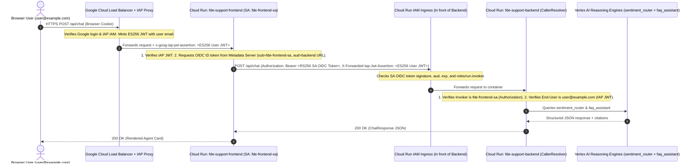

# Deep Dive: Multi-Hop Authentication on Google Cloud Run (IAP + OIDC + JWT)

This guide explains the security concepts, terminology, and exact root causes behind why the frontend UI (`fde-support-frontend`) failed to display responses from the backend (`fde-support-backend`) and Vertex AI agents (`sentiment_router` and `faq_assistant`).

---

## 1. Core Terminology Glossary

### 1.1 Identity & Token Fundamentals

* **JWT (JSON Web Token)**
  A compact, URL-safe token format used to pass cryptographically signed claims between parties. A JWT always consists of **three Base64URL-encoded parts separated by dots (`.`)**:
  `Header . Payload (Claims) . Signature` (`parts[0] . parts[1] . parts[2]`)
  * **Header (`parts[0]`)**: JSON metadata describing how the token is signed—specifically `alg` (the signing algorithm, e.g., `RS256` or `ES256`) and `kid` (the **Key ID** identifying which public key to use to verify the signature).
  * **Payload / Claims (`parts[1]`)**: JSON statements about the identity and validity of the token:
    * `iss` (**Issuer**): Who created and signed the token (e.g., `https://accounts.google.com` for Google OIDC, or `https://cloud.google.com/iap` for IAP).
    * `sub` (**Subject**): Unique immutable ID of the user or service account.
    * `email`: Human-readable email address of the user or service account.
    * `aud` (**Audience**): Who the token is intended for (e.g., the backend Cloud Run URL `https://fde-support-backend-...run.app` or the IAP backend service ID). **Crucial rule**: A server must verify that `aud` matches itself so a token meant for Service A cannot be replayed against Service B.
    * `iat` (**Issued At**) & `exp` (**Expiration Time**): Unix timestamps (in seconds) controlling the token's lifetime.
  * **Signature (`parts[2]`)**: Cryptographic signature computed over `Header.Payload` using the issuer's private key. Anyone with the issuer's public key can verify that the payload was not forged or modified.

* **OIDC (OpenID Connect) & ID Token**
  An identity layer built on top of OAuth 2.0. While an **OAuth Access Token** grants permission to call Google Cloud APIs (like Vertex AI or Firestore), an **OIDC ID Token** is a **JWT that proves *who* the caller is** to another application (like your Cloud Run service).

* **Access Token vs. ID Token**

  | Property | OAuth 2.0 Access Token | OIDC ID Token |
  | :--- | :--- | :--- |
  | **Format** | Opaque string (`ya29.c...`) | Structured JWT (`eyJ... . eyJ... . sig`) |
  | **Purpose** | Authorize calls to Google APIs (`*.googleapis.com`) | Prove caller identity to a custom service (e.g., Cloud Run) |
  | **Audience (`aud`)** | Scoped to Google API OAuth scopes | Scoped to a specific target URL (e.g., `https://fde-support-backend-...run.app`) |

### 1.2 Cryptographic Signing & Key Discovery

* **`RS256` (RSA Signature with SHA-256)**
  An asymmetric signing algorithm using a 2048-bit RSA keypair. Google's OIDC provider (`accounts.google.com`) signs service-account and user ID tokens using `RS256`. A raw 256-byte RSA signature encodes to **342 Base64URL characters** in `parts[2]`.
* **`ES256` (ECDSA using P-256 and SHA-256)**
  An elliptic-curve signing algorithm. Google's **Identity-Aware Proxy (IAP)** signs user identity assertions using `ES256`.
* **JWKS / Public Certificates Endpoint (`certs`)**
  To verify `RS256` or `ES256` signatures without sharing private keys, Google publishes its rotating public keys at well-known HTTPS endpoints:
  * **Google OIDC Public Certs (`RS256`)**: `https://www.googleapis.com/oauth2/v1/certs`
  * **Google IAP Public Keys (`ES256`)**: `https://www.gstatic.com/iap/verify/public_key-jwk`
  When verifying a JWT, your service reads `kid` from `parts[0]`, looks up the matching public key from the endpoint (caching it in memory), and verifies `parts[2]`.

### 1.3 Google Cloud Architecture Components

* **IAP (Identity-Aware Proxy)**
  Google Cloud's zero-trust access proxy sitting on the External Application Load Balancer (`https://34.8.166.104.nip.io`) in front of your frontend.
  1. When you visit the URL in your browser, IAP intercepts the request and checks your Google login session and IAM permissions (`roles/iap.httpsResourceAccessor`).
  2. Once authenticated, IAP injects a signed JWT header into the HTTP request before forwarding it to `fde-support-frontend`:
     `x-goog-iap-jwt-assertion: <ES256-signed JWT containing your user email>`

* **Cloud Run IAM (`roles/run.invoker` & `--no-allow-unauthenticated`)**
  When a Cloud Run service is deployed with `--no-allow-unauthenticated` (like `fde-support-backend`), Google's Cloud Run ingress proxy blocks every request at the network edge **unless** it carries a valid Google-signed OIDC ID token in `Authorization: Bearer <ID_TOKEN>` (or `X-Serverless-Authorization: Bearer <ID_TOKEN>`) belonging to a principal with the `roles/run.invoker` IAM permission.

* **Compute Metadata Server (`http://metadata.google.internal`)**
  An internal, link-local HTTP server accessible only from inside Google Cloud VMs and Cloud Run containers. A Cloud Run container's attached **Service Account** (e.g., `fde-frontend-sa@...`) requests target-scoped OIDC ID tokens from the metadata server at:
  `/computeMetadata/v1/instance/service-accounts/default/identity?audience=https://fde-support-backend-...run.app`

* **`SIGNATURE_REMOVED_BY_GOOGLE`**
  A special sentinel string that Google Cloud's serverless ingress proxy sometimes writes into the 3rd segment (`parts[2]`) of an incoming JWT after verifying it. **Why does Google do this?** If a caller sends a broad-audience user token (such as `gcloud auth print-identity-token`, whose `aud` is the shared Google Cloud SDK client ID), stripping the signature prevents a potentially untrusted container from stealing that user's token and replaying it against *other* Cloud Run services owned by the user.

---

## 2. End-to-End Request Architecture (Dual-Identity Pattern)

The application uses a **Defense-in-Depth Dual-Identity Architecture** across two hops:



When `fde-support-backend` receives a request from `fde-support-frontend`, there are **two separate tokens** in the HTTP headers serving **two distinct purposes**:

| Header | Token Type | Signing Algorithm | Who it identifies | Why the Backend checks it |
| :--- | :--- | :--- | :--- | :--- |
| `Authorization: Bearer <token>` | Service Account OIDC ID Token | `RS256` (Google OAuth2) | **The Invoker** (`fde-frontend-sa@...`) | Proves the HTTP call came through the trusted `fde-support-frontend` service. |
| `X-Forwarded-Iap-Jwt-Assertion: <token>` | IAP Assertion JWT | `ES256` (Google IAP) | **The End User** (`your-email@...`) | Proves which human user is logged in so the backend isolates their tickets in Firestore. |

---

## 3. Root Cause #1: The `SIGNATURE_REMOVED_BY_GOOGLE` Misconception

### What the Backend Expected

In `backend/security/caller_identity.py`, `invoker_email()` originally contained this strict check:

```python
parts = token.split(".")
if parts[2] != "SIGNATURE_REMOVED_BY_GOOGLE":
    raise CallerAuthError("invoker token was not verified by Cloud Run")
```

The original code assumed that **every** `Authorization: Bearer <token>` passing through Cloud Run IAM ingress has its 3rd JWT segment (`parts[2]`) replaced with the literal string `"SIGNATURE_REMOVED_BY_GOOGLE"`.

### How Cloud Run Ingress Actually Behaves

Cloud Run's ingress proxy handles `parts[2]` differently depending on **how the ID token was minted and which header carried it**:

| Scenario | How Token is Minted | Audience (`aud`) | What Cloud Run Ingress Does to `parts[2]` |
| :--- | :--- | :--- | :--- |
| **CLI / User Test** | `gcloud auth print-identity-token` (without `--audiences`) | Google Cloud SDK Client ID (`32555940559.apps...`) — **broad audience** | **Strips signature** -> replaces `parts[2]` with `SIGNATURE_REMOVED_BY_GOOGLE` so the container cannot replay the user's broad token elsewhere. |
| **X-Serverless-Authorization** | Any ID token passed in `X-Serverless-Authorization` | Service URL | **Strips signature** -> replaces `parts[2]` with `SIGNATURE_REMOVED_BY_GOOGLE`. |
| **Service-to-Service OIDC (Production UI)** | `google.oauth2.id_token.fetch_id_token(Request(), backend_url)` via Metadata Server | Exact target URL (`https://fde-support-backend-...run.app`) — **narrow audience** | Validates the token at ingress and **forwards the original 342-character `RS256` cryptographic signature intact**! |

### Why It Failed Only in the Browser UI (and Passed in CLI Tests!)

1. **When tested from the CLI** using `gcloud auth print-identity-token`, Cloud Run replaced `parts[2]` with `SIGNATURE_REMOVED_BY_GOOGLE`. And in unit tests (`tests/backend/test_backend_identity.py`), the test helper `_make_invoker_token()` hardcoded `signature="SIGNATURE_REMOVED_BY_GOOGLE"`. So both unit tests and CLI tests passed!
2. **When used from the Browser UI**, `frontend/server.py` called `id_token.fetch_id_token(Request(), BACKEND_URL)`, which asked the Compute Metadata Server for a service-account OIDC token scoped specifically to `BACKEND_URL`.
3. Cloud Run IAM verified `fde-frontend-sa`'s `roles/run.invoker` permission and forwarded the intact `RS256`-signed JWT to `fde-support-backend`.
4. `invoker_email()` saw a real 342-character cryptographic signature instead of `"SIGNATURE_REMOVED_BY_GOOGLE"` and immediately rejected the request with `HTTP 401 Unauthorized` (`Rejected request to /api/chat: invoker token was not verified by Cloud Run`).

### How We Fixed Root Cause #1

We updated `backend/security/caller_identity.py` so `CallerResolver` and `invoker_email()` accept **both** valid forms:

1. If `parts[2] == "SIGNATURE_REMOVED_BY_GOOGLE"`, Cloud Run ingress stripped the signature after verification, and we validate the claims (`iss`, `exp`, `email`, `email_verified`).
2. If `parts[2] != "SIGNATURE_REMOVED_BY_GOOGLE"`, we cryptographically verify the `RS256` signature against Google's official OIDC certificates (`https://www.googleapis.com/oauth2/v1/certs`, cached in memory for 1 hour) using `google.auth.crypt.RSAVerifier` before accepting the claims.

---

## 4. Root Cause #2: Frontend UI Swallowing Non-200 HTTP Responses

### What Happened in the Browser

When `fde-support-backend` returned `HTTP 401 Unauthorized` with JSON body `{"detail": "Authentication required"}`, `fde-support-frontend` forwarded that `401` status and JSON body back to the browser.

However, in `frontend/index.html`, `sendQuery()` did not check `if (!res.ok)`:

```javascript
const res = await fetch(`${BACKEND_URL}/api/chat`, { ... });
const data = await res.json();

// Only checked for 400 RESOLVED! Never checked if (!res.ok)!
if (res.status === 400 && data.detail && data.detail.includes("RESOLVED")) {
    alert(data.detail);
    disableChat();
    return;
}

// Fell straight through to rendering an Agent Card using undefined fields on `data`:
const isUrgent = data.sentiment === 'URGENT_FRUSTRATED'; // false -> '🟢 NEUTRAL / FACTUAL'
let answerText = data.answer || '';                      // '' (empty!)
```

Because `fetch()` in JavaScript **does not throw an exception on HTTP 4xx or 5xx responses** (it only rejects on network failures), `sendQuery()` treated the `401` error payload `{"detail": "Authentication required"}` as if it were a valid agent response—rendering an empty `🟢 NEUTRAL / FACTUAL` card (`Status: NEW | Routed To:`).

### How We Fixed Root Cause #2

In `frontend/index.html`, we added an explicit `if (!res.ok)` check right after checking for resolved tickets:

```javascript
if (!res.ok) {
    throw new Error(data.detail || data.error || `HTTP ${res.status}`);
}
```

And in the `catch (err)` block, we safely render the error detail using `textContent` (preventing XSS) instead of displaying a blank `NEUTRAL / FACTUAL` agent card.
